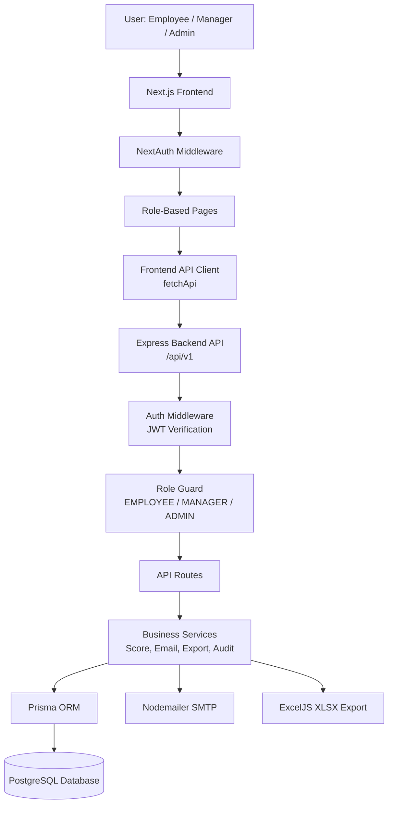
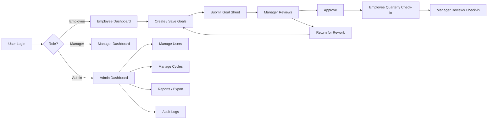
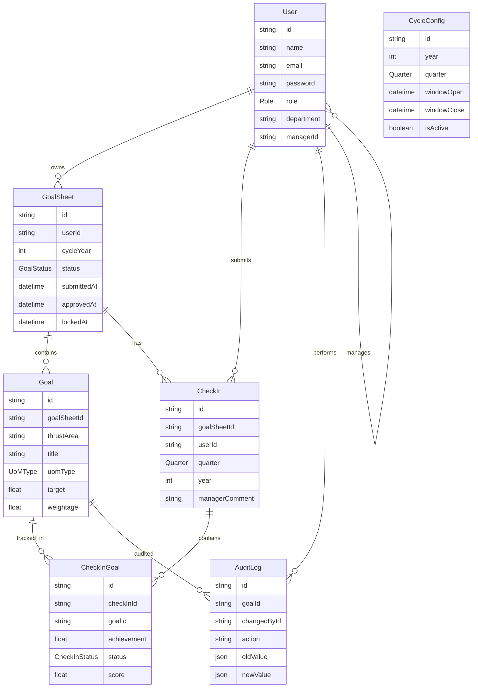
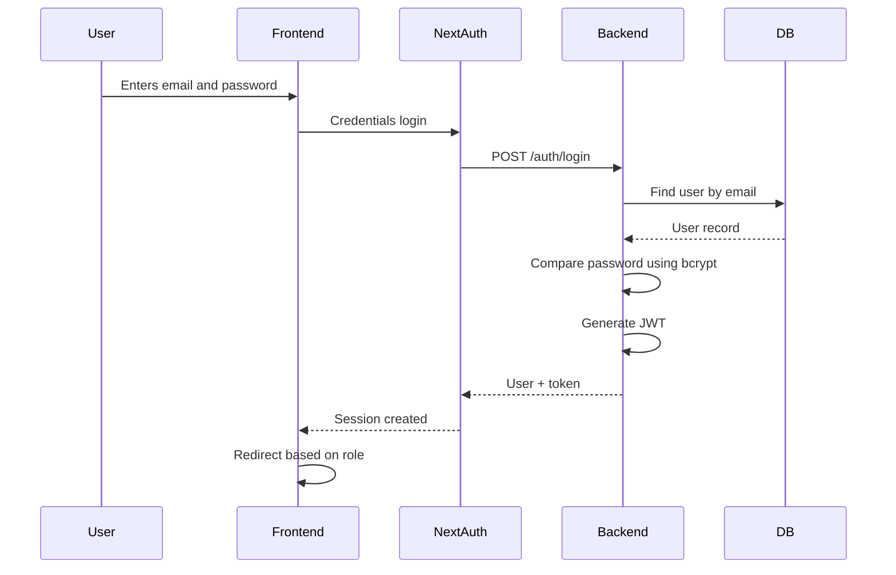
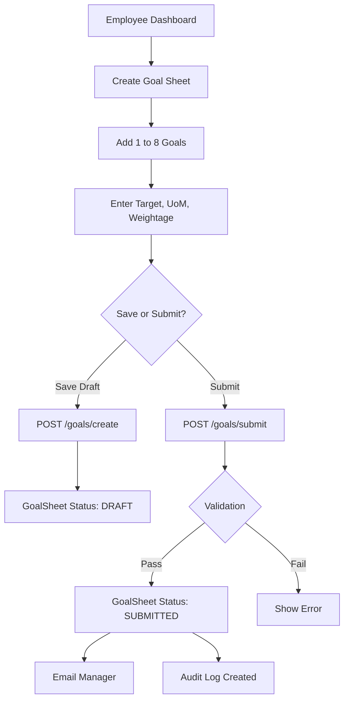
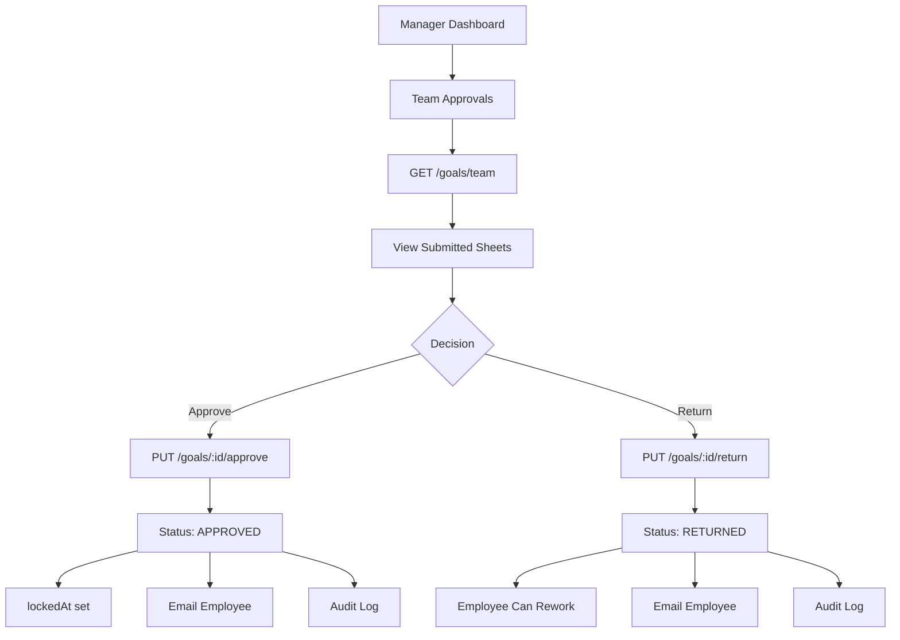
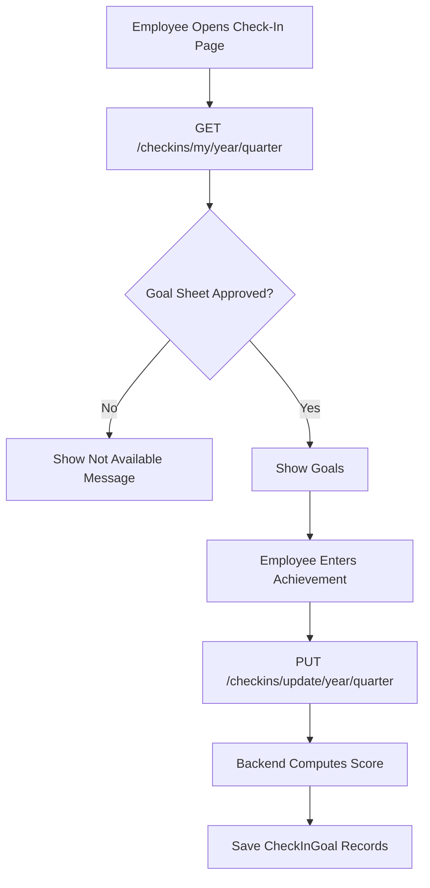
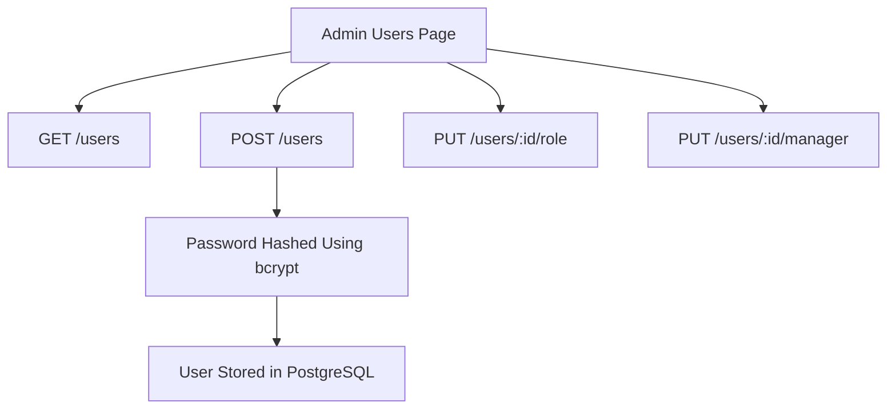
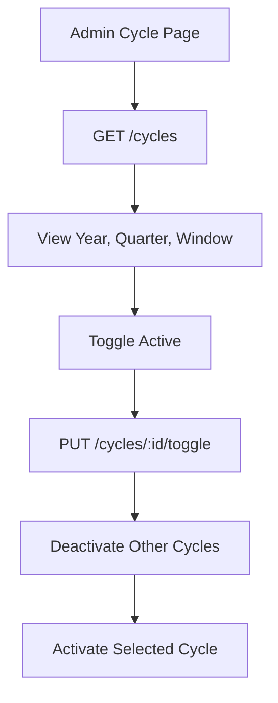
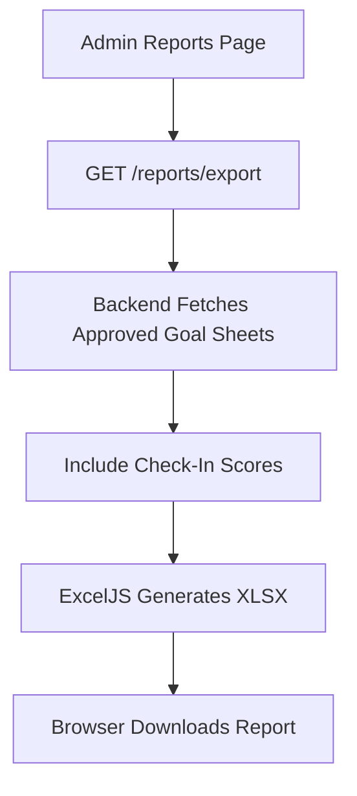

# In-House Goal Setting and Tracking Portal

## 1. Project Overview

This project is an **internal role-based goal management portal** for an organization. It helps employees create measurable goals, submit them to managers for review, track quarterly progress, and allows admins to manage users, cycles, reports, and audit activity.

In simple terms, it digitizes the company goal-setting workflow:

> Employee creates goals → Manager reviews and approves/returns → Employee updates progress every quarter → Admin monitors reports and audit history.

The project is split into two major parts:

| Layer | Purpose |
|---|---|
| **Frontend** | User interface built with Next.js, React, TypeScript, Tailwind CSS |
| **Backend** | REST API built with Express.js, TypeScript, Prisma, PostgreSQL |
| **Database** | Stores users, goals, check-ins, cycles, scores, audit logs |
| **Authentication** | NextAuth on frontend, JWT on backend |
| **Reporting** | Excel export using ExcelJS |

---

## 2. What Problem Does This Project Solve?

Many organizations manage employee goals using spreadsheets, emails, or manual HR documents. This causes problems like:

- No centralized system for goal creation and approval
- Difficulty tracking whether employees submitted goals
- Managers manually reviewing goals through emails or files
- Lack of progress visibility during the year
- No structured check-in mechanism
- No audit trail for important actions
- Difficult reporting for HR/admin teams

This portal solves those problems by providing:

- A single place for employees to create goals
- A manager approval workflow
- Quarterly check-ins for progress tracking
- Role-based access for employees, managers, and admins
- Admin-level user, cycle, report, and audit management
- Structured database-backed reporting

---

## 3. Main Users and Roles

### Employee

An **employee** is the person who creates and tracks their own goals.

Employee can:

- Create a goal sheet
- Save goal sheet as draft
- Submit goals to manager
- Edit returned goals
- View approval status
- Submit quarterly check-ins after approval

### Manager

A **manager** reviews the goals submitted by employees assigned under them.

Manager can:

- View team goal sheets
- Approve submitted goals
- Return goals for rework
- Review quarterly check-ins
- Add comments on employee progress

### Admin

An **admin** manages organization-level configuration.

Admin can:

- Manage users
- Assign managers to employees
- Update user roles
- Manage active goal cycles
- View reports
- Export reports to Excel
- View audit logs

---

# 4. Tech Stack

## Frontend Tech Stack

| Technology | Usage |
|---|---|
| **Next.js 16** | Full-stack React framework used for routing, layouts, pages, middleware |
| **React 19** | Builds reusable UI components |
| **TypeScript** | Adds type safety |
| **Tailwind CSS** | Utility-first CSS styling |
| **NextAuth** | Frontend authentication/session management |
| **React Hook Form** | Form state management |
| **Zod** | Schema validation |
| **Recharts** | Charts on admin dashboard |
| **Lucide React** | Icons |
| **React Hot Toast** | Success/error notifications |

## Backend Tech Stack

| Technology | Usage |
|---|---|
| **Node.js** | JavaScript runtime |
| **Express.js** | REST API server |
| **TypeScript** | Type-safe backend development |
| **Prisma ORM** | Database access layer |
| **PostgreSQL** | Relational database |
| **JWT** | Backend token authentication |
| **bcrypt** | Password hashing |
| **Zod** | Request validation |
| **Helmet** | Security headers |
| **CORS** | Allows frontend-backend communication |
| **Morgan** | Request logging |
| **Nodemailer** | Email notifications |
| **ExcelJS** | Excel report generation |

---

# 5. Architecture Diagram



---

# 6. High-Level System Flow



---

# 7. Folder Structure

```text
In-House-Goal-Setting-and-Tracking-Portal
│
├── frontend
│   ├── app
│   │   ├── employee
│   │   ├── manager
│   │   ├── admin
│   │   └── api/auth/[...nextauth]
│   ├── components
│   │   ├── layout
│   │   └── ui
│   ├── lib
│   │   ├── api.ts
│   │   ├── auth.ts
│   │   ├── validations.ts
│   │   └── utils.ts
│   └── types
│
└── backend
    ├── prisma
    │   ├── schema.prisma
    │   └── seed.ts
    └── src
        ├── routes
        ├── middleware
        ├── services
        └── lib
```

---

# 8. Database Architecture

## Main Database Models



---

# 9. Important Keywords Defined

## Goal Sheet

A **goal sheet** is a yearly collection of goals created by an employee. One employee can have one goal sheet per year.

Example:

> Alice's 2026 Goal Sheet contains 5 goals with total weightage 100%.

## Goal

A **goal** is a measurable objective.

Example:

> Increase customer satisfaction score to 90%.

Each goal has:

- Thrust area
- Title
- Description
- Unit of measurement
- Target
- Weightage

## Weightage

**Weightage** means importance percentage assigned to a goal.

Example:

| Goal | Weightage |
|---|---|
| Revenue Growth | 40% |
| Customer Experience | 30% |
| Process Improvement | 30% |

Total must be exactly **100%**.

## Thrust Area

A **thrust area** is a business focus category.

Examples from the project:

- Revenue Growth
- Operational Efficiency
- Customer Experience

## UoM Type

**UoM** means **Unit of Measurement**. It defines how a goal is measured.

The project supports:

| UoM Type | Meaning | Example |
|---|---|---|
| `NUMERIC_MIN` | Higher achievement is better | Sell at least 100 units |
| `NUMERIC_MAX` | Lower achievement is better | Keep defects below 5 |
| `TIMELINE` | Completion before deadline matters | Finish project by June 30 |
| `ZERO` | Target is zero errors/incidents | Zero compliance violations |

## Check-In

A **check-in** is a quarterly progress update against approved goals.

Example:

> In Q1, employee updates achievement, status, and completion data.

## Audit Log

An **audit log** records important system actions.

Example:

- Goal sheet submitted
- Goal sheet approved
- Goal sheet returned
- Locked goal edited

This helps with accountability.

## Cycle

A **cycle** defines a goal-setting window for a year and quarter.

Example:

> 2026 Q1 cycle is active from Jan 1 to Jan 31.

Employees can submit goals only when the active cycle window is open.

---

# 10. Detailed Project Flow

## 10.1 Login Flow



### Explanation

1. User enters email and password.
2. NextAuth sends credentials to backend `/auth/login`.
3. Backend checks if user exists.
4. Password is verified using **bcrypt**.
5. Backend creates a **JWT token**.
6. NextAuth stores token in frontend session.
7. User is redirected based on role:

| Role | Redirect |
|---|---|
| Admin | `/admin/dashboard` |
| Manager | `/manager/dashboard` |
| Employee | `/employee/dashboard` |

---

## 10.2 Employee Goal Creation Flow



### Rules Applied

The backend validates:

- Minimum 1 goal
- Maximum 8 goals
- Each goal must have at least 10% weightage
- Total weightage must equal 100%
- Numeric goals must have target greater than 0
- Timeline goals must have a deadline
- Employee must have an assigned manager
- Active goal submission cycle must exist
- Submission window must be open

---

## 10.3 Manager Approval Flow



### Explanation

Manager can only review employees assigned to them.

If approved:

- Goal sheet status becomes `APPROVED`
- `approvedAt` timestamp is stored
- `lockedAt` timestamp is stored
- Employee can now perform check-ins

If returned:

- Goal sheet status becomes `RETURNED`
- Employee can edit and resubmit
- Manager comment is included in audit/email

---

## 10.4 Employee Check-In Flow



### Explanation

Check-ins are available only if the goal sheet is:

- `APPROVED`, or
- `LOCKED`

For every goal, the employee submits progress.

The backend computes score based on UoM type.

---

# 11. Score Calculation Logic

The scoring logic is implemented in the backend score service.

## 11.1 NUMERIC_MIN

Used when higher achievement is better.

Formula:

```text
score = achievement / target * 100
maximum score = 100
```

Example:

| Target | Achievement | Score |
|---|---:|---:|
| 100 | 80 | 80% |
| 100 | 120 | 100% |

## 11.2 NUMERIC_MAX

Used when lower achievement is better.

Formula:

```text
score = target / achievement * 100
maximum score = 100
```

Example:

| Target | Achievement | Score |
|---|---:|---:|
| 5 defects | 10 defects | 50% |
| 5 defects | 5 defects | 100% |

## 11.3 TIMELINE

Used when completing before deadline matters.

```text
If completion date <= deadline, score = 100
Else score = 0
```

## 11.4 ZERO

Used for zero-tolerance goals.

```text
If achievement = 0, score = 100
Else score = 0
```

Example:

> Zero security incidents.  
> If incidents = 0, score is 100.  
> If incidents > 0, score is 0.

---

# 12. Admin Flow

## 12.1 User Management

Admin can:

- View all users
- Create users
- Assign roles
- Assign employees to managers
- Remove manager assignment if role changes



---

## 12.2 Cycle Management

Admin controls active submission windows.



Only one active cycle is allowed at a time.

---

## 12.3 Reports

Admin can export achievement reports.



Report includes:

- Employee name
- Department
- Goal title
- Thrust area
- UoM type
- Target
- Q1 to Q4 actual values
- Q1 to Q4 scores

---

## 12.4 Audit Logs

Audit logs track important workflow events.

Tracked actions include:

- `GOAL_SHEET_SUBMITTED`
- `GOAL_SHEET_APPROVED`
- `GOAL_SHEET_RETURNED`
- `GOAL_EDITED_POST_LOCK`

This helps answer:

- Who changed something?
- What action happened?
- When did it happen?
- What was the old value?
- What is the new value?

---

# 13. Backend API Overview

## Auth APIs

| Method | Endpoint | Purpose |
|---|---|---|
| POST | `/auth/login` | Login user |
| GET | `/auth/me` | Get current user |

## Goal APIs

| Method | Endpoint | Role | Purpose |
|---|---|---|---|
| GET | `/goals/my-sheet/:year` | Employee | Fetch own goal sheet |
| POST | `/goals/create` | Employee | Save draft |
| POST | `/goals/submit` | Employee | Submit to manager |
| GET | `/goals/team` | Manager/Admin | View team sheets |
| PUT | `/goals/:id/approve` | Manager/Admin | Approve sheet |
| PUT | `/goals/:id/return` | Manager/Admin | Return sheet |
| PUT | `/goals/:goalId/edit` | Manager/Admin | Edit target/weightage |

## Check-In APIs

| Method | Endpoint | Role | Purpose |
|---|---|---|---|
| GET | `/checkins/my/:year/:quarter` | Employee | Fetch own check-in |
| PUT | `/checkins/update/:year/:quarter` | Employee | Save check-in |
| GET | `/checkins/team/:year/:quarter` | Manager/Admin | View team check-ins |
| PUT | `/checkins/:id/comment` | Manager/Admin | Add manager comment |

## Admin APIs

| Method | Endpoint | Purpose |
|---|---|---|
| GET | `/users` | List users |
| POST | `/users` | Create user |
| PUT | `/users/:id/role` | Update role |
| PUT | `/users/:id/manager` | Assign manager |
| GET | `/cycles` | List cycles |
| POST | `/cycles` | Create/update cycle |
| PUT | `/cycles/:id/toggle` | Activate/deactivate cycle |
| GET | `/reports/export` | Export Excel report |
| GET | `/audit/logs` | View audit trail |

---

# 14. Authentication and Authorization

## Authentication

**Authentication** means verifying who the user is.

This project uses:

- Email/password login
- Password hashing using bcrypt
- JWT token generated by backend
- NextAuth session on frontend

## Authorization

**Authorization** means checking what the logged-in user is allowed to do.

This project has authorization in two places:

### Frontend

Next.js middleware prevents users from opening pages for other roles.

Example:

- Employee cannot access `/admin`
- Manager cannot access `/admin`
- Admin can access admin routes

### Backend

Express middleware validates JWT and checks role using `roleGuard`.

This is more important because frontend checks can be bypassed, but backend checks protect the actual data.

---

# 15. Why This Tech Stack Was Chosen

## Q1. Why Next.js?

**Answer:**

Next.js provides routing, layouts, middleware, API support, and performance optimizations on top of React.

Benefits:

- File-based routing
- Server-side session checks
- Middleware for protected routes
- Good structure for role-based dashboards
- Production-ready React framework

## Q2. Why React?

**Answer:**

React makes it easy to build reusable UI components like buttons, cards, tables, modals, and dashboards.

Benefits:

- Component reuse
- Fast UI updates
- Strong ecosystem
- Good developer productivity

## Q3. Why TypeScript?

**Answer:**

TypeScript adds static typing to JavaScript.

Benefits:

- Fewer runtime errors
- Better autocomplete
- Easier refactoring
- Clearer API contracts
- Useful for large projects with frontend and backend

## Q4. Why Tailwind CSS?

**Answer:**

Tailwind CSS allows fast styling using utility classes.

Benefits:

- No need to write large CSS files
- Consistent spacing, colors, and layout
- Faster UI development
- Easy responsive design

## Q5. Why Express.js?

**Answer:**

Express is a lightweight Node.js framework for building REST APIs.

Benefits:

- Simple routing
- Middleware support
- Easy integration with JWT, Prisma, CORS, Helmet
- Good for building structured backend APIs

## Q6. Why Prisma?

**Answer:**

Prisma is an ORM, meaning it helps interact with the database using TypeScript instead of raw SQL.

Benefits:

- Type-safe database queries
- Easy schema management
- Clear relationships between models
- Reduces manual SQL errors
- Easier migrations and seed data

## Q7. Why PostgreSQL?

**Answer:**

PostgreSQL is a powerful relational database.

Benefits:

- Good for structured data
- Supports relationships between users, goals, check-ins
- Reliable for enterprise applications
- Supports constraints like unique email and unique goal sheet per user/year

## Q8. Why JWT?

**Answer:**

JWT allows backend APIs to verify requests using a signed token.

Benefits:

- Stateless authentication
- Works well with REST APIs
- Token carries user ID and role
- Easy to send in Authorization header

## Q9. Why bcrypt?

**Answer:**

bcrypt securely hashes passwords.

Benefits:

- Plain passwords are not stored
- Protects users if database is leaked
- Industry-standard password hashing approach

## Q10. Why Zod?

**Answer:**

Zod validates data before it is processed.

Benefits:

- Prevents invalid input
- Same validation style can be used in frontend and backend
- Gives clear error messages
- Helps enforce business rules like total weightage = 100%

## Q11. Why ExcelJS?

**Answer:**

ExcelJS creates downloadable Excel reports.

Benefits:

- Useful for HR/admin reporting
- Generates `.xlsx` files
- Supports structured rows and columns
- Easy offline analysis in Excel

## Q12. Why Recharts?

**Answer:**

Recharts is used for charts in the admin dashboard.

Benefits:

- React-friendly charts
- Easy bar charts and dashboards
- Helps visualize completion rates

---

# 16. Strengths of the Project

- Clear separation between frontend and backend
- Role-based workflows for employee, manager, and admin
- Backend authorization using JWT and role guards
- Validation on both frontend and backend
- Prisma schema defines strong relational data model
- Audit logging for important workflow events
- Excel export for admin reporting
- Email notifications for goal submission/approval/return
- Goal scoring logic supports multiple measurement types
- Active cycle management controls submission windows

---

# 17. Vulnerabilities, Bugs, and Limitations

## 17.1 Hardcoded Current Quarter

The employee dashboard and check-in flow currently use `Q1` as a simplified value.

Risk:

- In Q2, Q3, or Q4, users may still see or submit Q1 check-ins unless manually changed.

Improvement:

- Determine quarter dynamically from current date or active cycle.

---

## 17.2 Admin Dashboard Uses Sample Chart Data

Admin dashboard chart data is mocked.

Risk:

- Dashboard percentages may not reflect real organization data.

Improvement:

- Connect chart to real reports/check-in APIs.

---

## 17.3 No Refresh Token Flow

JWT expires in 1 day.

Risk:

- User may be logged out after token expiry.
- No refresh-token mechanism for seamless sessions.

Improvement:

- Add refresh tokens or NextAuth backend token refresh handling.

---

## 17.4 Limited Password Policy

Password minimum is 6 characters.

Risk:

- Weak passwords can be used.

Improvement:

- Require stronger passwords with uppercase, lowercase, number, symbol.
- Add password reset flow.

---

## 17.5 No Rate Limiting on Login

Login endpoint does not appear to have rate limiting.

Risk:

- Brute-force login attempts are possible.

Improvement:

- Add rate limiting using libraries like `express-rate-limit`.

---

## 17.6 Email Sending Is Fire-and-Forget

Email functions are called asynchronously and errors are only logged.

Risk:

- Goal workflow succeeds even if email fails.
- Users may miss important notifications.

Improvement:

- Store email delivery status.
- Add retry mechanism or notification table.

---

## 17.7 Manager Return Comment Not Stored on GoalSheet

Return comments are included in audit/email but not directly stored on the goal sheet.

Risk:

- Employee UI may not easily show the exact latest manager feedback.

Improvement:

- Add `returnComment` or `managerFeedback` field to `GoalSheet`.

---

## 17.8 Check-In Submission Window Not Enforced

Goal submission uses active cycle window checks, but check-ins do not appear to enforce quarter-specific windows.

Risk:

- Employees may update check-ins outside expected time.

Improvement:

- Add check-in window dates to cycle configuration.

---

## 17.9 No Automated Tests

The backend test script currently only returns an error placeholder.

Risk:

- Regressions can happen unnoticed.

Improvement:

- Add unit tests for score calculation.
- Add API tests for auth, role guards, goals, check-ins.
- Add frontend component or Playwright tests.

---

## 17.10 No Pagination for Large Admin Tables

Users, audit logs, reports, and goal sheets load all matching records.

Risk:

- Performance can degrade for large organizations.

Improvement:

- Add pagination, filtering, and search.

---

## 17.11 Audit Logging Is Partial

Audit logs exist for major workflow actions, but not every admin operation is logged.

Risk:

- User role changes or manager assignments may not be fully traceable.

Improvement:

- Add audit logs for user creation, role changes, manager assignment, cycle activation.

---

## 17.12 Goal Editing After Approval Is Restricted but Not Fully Used in UI

Backend has an endpoint for manager/admin editing target/weightage, including audit logging for locked goals, but the current approvals UI mainly shows approve/return.

Risk:

- Feature may be incomplete from UI perspective.

Improvement:

- Add manager inline editing UI before approval.

---

# 18. Future Improvements

## Functional Improvements

- Dynamic quarter detection
- Real admin dashboard analytics
- Password reset flow
- Employee feedback display for returned sheets
- Manager inline goal editing UI
- Check-in approval workflow
- Notifications inside the app
- Department-wise dashboards
- Advanced report filters by year, quarter, department, manager
- Bulk user upload through Excel/CSV
- Goal history/versioning
- Multi-year comparison reports
- Employee self-assessment comments
- Manager final rating or appraisal score

## Technical Improvements

- Add automated tests
- Add rate limiting
- Add centralized logging
- Add pagination
- Add API documentation using Swagger/OpenAPI
- Add Docker setup
- Add CI/CD pipeline
- Add environment-specific configuration
- Add database indexes for reporting queries
- Add refresh-token authentication
- Add stricter password policy
- Add row-level authorization tests

## Security Improvements

- Add login attempt throttling
- Add account lockout after repeated failures
- Add audit logs for admin changes
- Add CSRF review for authentication flow
- Add secure cookie configuration review
- Add input sanitization where rich text may be introduced
- Add security monitoring for suspicious login activity

---

# 19. Interview Summary

This project is an **enterprise-style internal goal management system** built with **Next.js, React, TypeScript, Express, Prisma, and PostgreSQL**.

It supports three roles:

- Employees create goals and submit check-ins.
- Managers approve goals and review progress.
- Admins manage users, cycles, reports, and audit logs.

The project solves the problem of manual goal tracking by creating a centralized, role-based workflow with validation, approval, scoring, reporting, and auditability.

A strong interview explanation would be:

> “I built an in-house goal setting and tracking portal where employees can create weighted annual goals, submit them to their managers, and track quarterly progress. Managers can approve, return, and comment on goals and check-ins. Admins manage users, reporting cycles, audit logs, and Excel exports. The frontend is built with Next.js, React, TypeScript, Tailwind, and NextAuth. The backend is built with Express, TypeScript, Prisma, PostgreSQL, JWT authentication, Zod validation, and ExcelJS reporting. The system uses role-based access control, database relationships, structured validation, and score computation logic for different goal measurement types.”
