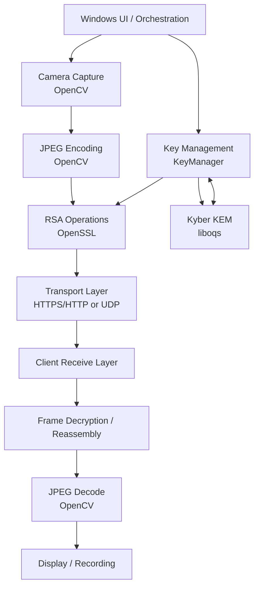
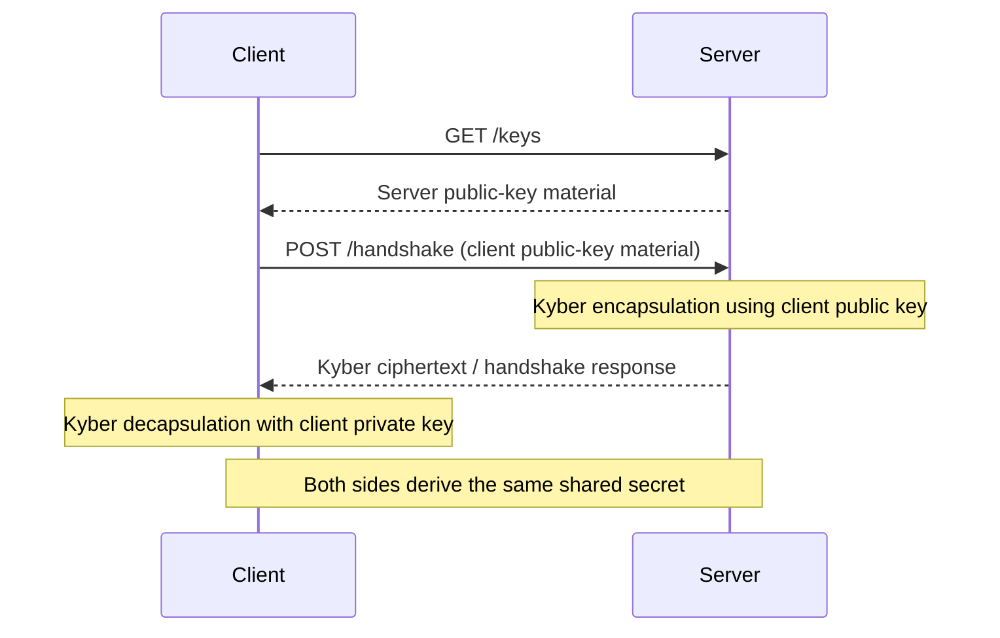

# StreamOn — Project Understanding & Architecture Guide
**Phase 1 of 2 · Technical Interview Preparation**

> **Scope and evidence note:** This guide is based on the supplied `README.md` and the existing StreamOn interview-notes file. The README describes the project as a Windows-focused C++ prototype for secure webcam streaming. The notes contain more detailed implementation claims about the HTTP/HTTPS GUI path and the UDP socket path. The full source files referenced by those notes were not included in the uploaded materials, so code-level details below are treated as **documented in the notes, not independently verified against source code**. Confirm them against the repository before presenting them as exact implementation facts.

---

## Table of Contents

1. [Project Overview](#1-project-overview)
2. [Technology Stack](#2-technology-stack)
3. [Architecture](#3-architecture)
4. [End-to-End Workflows](#4-end-to-end-workflows)
5. [Implementation Details](#5-implementation-details)
6. [Key Technical Decisions and Trade-offs](#6-key-technical-decisions-and-trade-offs)
7. [Limitations and Future Improvements](#7-limitations-and-future-improvements)
8. [Interview Summary](#8-interview-summary)
9. [Items to Confirm Against Source Code](#9-items-to-confirm-against-source-code)

---

## 1. Project Overview

### 1.1 What is StreamOn?

StreamOn is a **C++ desktop prototype for transmitting webcam video from a server to a client with a focus on encryption and post-quantum key establishment**. It captures camera frames, compresses them into JPEG bytes, protects the payload using the cryptographic approach implemented by the selected build, transmits the data, and reconstructs the video on the client.

The project combines real-time media processing with network programming and cryptography. It is best presented as a **proof of concept / learning project**, rather than a production-ready secure streaming product.

### 1.2 Problem and motivation

A live camera feed can expose private information if an unauthorized party can intercept the traffic. StreamOn explores how to protect video transmission by:

- capturing frames locally and encoding them before transmission;
- performing a client-server key exchange before streaming;
- encrypting frame data before it crosses the network;
- decrypting and displaying the received frames;
- exploring a post-quantum key-establishment mechanism alongside classical cryptography.

The post-quantum motivation is that RSA-based key establishment can be vulnerable to sufficiently capable quantum computers. A post-quantum key-encapsulation mechanism is included to explore how a session secret can be established with a design intended to resist known quantum attacks on conventional public-key cryptography.

### 1.3 Objectives

1. Demonstrate webcam capture and live frame delivery between a server and client.
2. Integrate classical cryptography and post-quantum key encapsulation into a native C++ application.
3. Separate media capture, key management, frame transformation, networking, and UI responsibilities.
4. Explore the trade-offs between a more structured HTTP/HTTPS approach and a low-latency UDP socket approach.
5. Provide a Windows desktop interface for starting/stopping the application and viewing the stream.

### 1.4 Main capabilities described in the supplied material

- Webcam capture and JPEG frame encoding using OpenCV.
- RSA key generation and frame-chunk encryption in the documented GUI/HTTPS path.
- Kyber512 key generation and encapsulation/decapsulation through `liboqs`.
- Client-server public-key exchange and handshake.
- Encrypted frame transfer, decryption, JPEG decoding, and display.
- A Windows desktop UI to start and stop the server/client and view video.
- Video recording support.
- Local persistence of cryptographic key material.
- A separate UDP-oriented implementation described in the existing interview notes, with custom packet chunking and frame reassembly.

**Important distinction:** The notes describe two network implementations. Do not imply that both transports are used simultaneously in one streaming session unless the source code confirms that.

### 1.5 Target users and practical applications

The most direct audience is developers or students learning about:

- secure client-server communication;
- native C++ networking and concurrency;
- webcam/media pipelines;
- integration of cryptographic libraries;
- the engineering trade-offs involved in low-latency video.

Potential application areas for the concepts include private camera feeds, remote monitoring, and secure video transport prototypes. These are **possible application areas**, not claims that StreamOn is already suitable for deployment in those settings.

---

## 2. Technology Stack

| Technology | Role in StreamOn | Why it fits the project | Important caveat |
|---|---|---|---|
| **C++17** | Main implementation language for networking, media handling, cryptography wrappers, and desktop integration | Native performance, explicit control over buffers and threads, and compatibility with the chosen Windows libraries | Manual resource management and concurrency require care |
| **OpenCV** | Camera capture, frame processing, JPEG encoding/decoding, and video display support | Provides a practical API for working with webcam frames and image formats | Encoding/decoding and repeated buffer allocations can add CPU and memory cost |
| **OpenSSL** | RSA cryptographic operations and TLS support in the HTTPS build | Established cryptographic library with C/C++ integration | RSA is not an appropriate bulk-encryption method for a production video stream |
| **liboqs** | Kyber512 key encapsulation | Provides a C API for post-quantum cryptographic algorithms | Algorithm naming and availability may depend on the installed library version; modern standardized naming uses ML-KEM |
| **WinSock2 / Windows sockets** | UDP socket communication in the socket-oriented implementation | Native Windows networking APIs and direct control over datagrams | UDP does not guarantee delivery, ordering, or duplicate suppression |
| **cpp-httplib (`httplib`)** | HTTP/HTTPS server/client endpoints in the HTTP-oriented implementation | Lightweight C++ HTTP integration and route handlers | Polling creates repeated request overhead and adds latency |
| **Win32 API / GDI** | Desktop windowing, UI event handling, and rendering frames inside native Windows windows | Integrates video into a native Windows desktop UI | Windows-specific and less portable than a cross-platform UI layer |
| **CMake** | Build configuration for the GUI-side project | Describes targets, dependencies, and build steps | The exact dependency configuration must match the local environment |
| **Visual Studio 2022 / batch scripts** | Windows build workflow and native toolchain | Fits the project's Windows dependencies | Paths and runtime DLL setup are machine-dependent |
| **Standard C++ threading utilities** | Background camera/network work and synchronization, as described in the notes | Keeps long-running work away from the UI message loop | Mutex ownership, shutdown order, and buffer lifetime need careful validation |

### 2.1 Cryptographic roles: keep these distinct

- **RSA-2048:** In the documented GUI/HTTPS path, RSA public-key operations are used to encrypt frame chunks. The interview notes identify OAEP padding and a 214-byte maximum plaintext chunk when using RSA-2048 with OAEP/SHA-1.
- **Kyber512:** A key-encapsulation mechanism (KEM), not a bulk video cipher. Encapsulation produces ciphertext and a shared secret; decapsulation recovers the same shared secret.
- **TLS:** Protects the HTTP connection when configured correctly. TLS security depends on correct certificate validation and configuration.
- **Repeating-key XOR:** The existing notes describe this in the UDP implementation. It is a demonstration shortcut, **not secure encryption**, and must not be described as production-grade protection.
- **Recommended production direction:** Use the key-establishment phase to derive/obtain session key material, then encrypt media payloads with an authenticated symmetric cipher such as AES-GCM or ChaCha20-Poly1305. This is a recommendation, not a claim about the current implementation.

---

## 3. Architecture

### 3.1 Logical component architecture

The system can be understood as a pipeline with five main concerns: user interface/orchestration, media capture, cryptography, transport, and client-side reconstruction/display.



This is a **logical diagram**, not a claim that every component is called in precisely this order in every build. The exact connections differ between the HTTP/HTTPS implementation and the UDP implementation.

### 3.2 Network variants

The supplied README and notes describe two approaches. Treat them as separate variants unless source inspection confirms a shared runtime configuration.

```mermaid
flowchart LR
    subgraph A[HTTP/HTTPS-oriented GUI path]
        A1[Camera / JPEG]
        A2[Frame processing<br/>RSA chunk encryption]
        A3[HTTP(S) server<br/>cpp-httplib + OpenSSL]
        A4[HTTP(S) client<br/>polls for frames]
        A5[Decrypt / decode / display]
        A1 --> A2 --> A3 --> A4 --> A5
    end

    subgraph B[UDP-oriented socket path]
        B1[Camera / JPEG]
        B2[Prototype payload transform<br/>notes describe repeating XOR]
        B3[Custom chunk/header creation]
        B4[UDP datagrams<br/>WinSock2]
        B5[Chunk collection / reassembly]
        B6[Decode / display]
        B1 --> B2 --> B3 --> B4 --> B5 --> B6
    end
```

#### HTTP/HTTPS-oriented path

- Uses HTTP endpoints for control/key exchange and frame retrieval.
- The notes identify `GET /keys`, `POST /handshake`, and `GET /frames`.
- The frame endpoint is described as returning the latest encrypted frame; if no frame is available, it may return `204 No Content`.
- This approach is comparatively straightforward to inspect and debug, but polling adds repeated request overhead and latency.

#### UDP-oriented path

- Uses Windows datagram sockets and a custom packet header for frame chunking.
- The notes describe a header with packet type, frame ID, total chunk count, and chunk index.
- The receiver uses frame/chunk identifiers to place chunks in order and reconstruct a frame.
- UDP can reduce transport overhead and avoid TCP head-of-line blocking, but packet loss and out-of-order delivery must be handled at the application level.
- The existing notes describe repeating-key XOR for payload transformation in this path. This is **not secure encryption** and is a major limitation.

### 3.3 Component responsibilities

| Component | Responsibility |
|---|---|
| **UI / application entry point** | Starts and stops the relevant services, receives UI events, and coordinates user-facing actions |
| **Camera capture** | Acquires frames from the webcam and provides image data to the pipeline |
| **JPEG encoding/decoding** | Converts OpenCV frames to compact byte payloads and reconstructs image matrices on receipt |
| **KeyManager** | Coordinates local and remote key material, key generation/loading, and client/server handshake operations |
| **RSACrypto** | Wraps RSA-related operations and key serialization/handling using OpenSSL |
| **KyberKEM** | Wraps `liboqs` keypair, encapsulation, and decapsulation operations |
| **FrameEncryptor / FrameDecryptor** | Transforms frame bytes into the encrypted payload format and reverses that transformation |
| **StreamServer / StreamClient** | Owns the HTTP(S)-oriented server/client communication described in the notes |
| **UDP server/client logic** | Handles socket setup, packetization, transmission, receiving, and reassembly in the UDP-oriented path |
| **Recording component** | Writes captured frames to a video file when recording is enabled |
| **Windows UI rendering** | Displays received frames inside the desktop window; the notes describe GDI rendering in the GUI path |

### 3.4 Key exchange sequence in the HTTP/HTTPS notes

The notes describe this high-level handshake:



The notes specify a Kyber512 ciphertext of 768 bytes and a 32-byte shared secret. The shared secret's role in the current implementation needs to be explained carefully: the existing notes say the GUI frame-encryption path still encrypts frame chunks using RSA, while the Kyber secret is not used as the bulk frame cipher. Confirm this in the source before describing any additional use.

**Security nuance:** Public-key exchange by itself does not authenticate the peer. Authentication depends on how keys are bound to identities and how the transport/certificates are validated. The notes also flag disabled server certificate verification in the local HTTPS client configuration as a prototype weakness.

---

## 4. End-to-End Workflows

### 4.1 HTTP/HTTPS-oriented frame workflow

1. **Initialize the application.** The UI starts the server/client components and initializes camera and cryptographic dependencies.
2. **Prepare key material.** The key manager generates or loads local RSA and Kyber key material according to the application's persistence behavior.
3. **Perform the handshake.** The client requests server public keys and submits its own public-key material. The server performs Kyber encapsulation; the client decapsulates the response to obtain the shared secret.
4. **Capture a frame.** OpenCV reads a frame from the webcam into a `cv::Mat`.
5. **Compress the frame.** The frame is encoded as JPEG bytes to reduce the payload size before network transmission.
6. **Transform/encrypt the bytes.** In the documented GUI path, `FrameEncryptor` divides JPEG bytes into chunks small enough for RSA-OAEP and encrypts each chunk using the appropriate RSA public key.
7. **Make the payload available.** The server exposes the latest encrypted frame through the frame endpoint.
8. **Retrieve the frame.** The client requests the latest available payload over HTTP(S).
9. **Decrypt and reconstruct.** `FrameDecryptor` validates ciphertext block alignment, decrypts chunks, and joins the plaintext bytes. If a block fails decryption, the frame should be rejected.
10. **Decode and render.** OpenCV decodes the JPEG bytes into an image matrix, which is displayed in the client UI.
11. **Record if enabled.** The project README documents recording support. The notes describe an AVI/MJPEG implementation; confirm the exact recording path and whether writes are synchronous in the source.

### 4.2 UDP-oriented workflow

1. Capture a webcam frame and encode it as JPEG.
2. Apply the payload transformation described in the UDP implementation notes. Those notes describe repeating-key XOR, which is insecure and should be replaced before any real deployment.
3. Divide the payload into datagrams that fit a conservative application payload limit.
4. Attach packet metadata such as frame ID, total chunk count, and chunk index.
5. Send the chunks over UDP.
6. On the receiver, group chunks by frame and place them using their chunk indices so out-of-order packets can be handled.
7. If the frame is incomplete, discard it rather than rendering a corrupted image; the notes describe dropping an incomplete frame when a newer frame arrives.
8. Reconstruct the payload, decode the JPEG, and display the frame.

### 4.3 Threading and responsiveness

The existing notes describe a model in which UI message handling is separated from camera capture and network operations. In the GUI path, `PostMessage` is described as a way to notify the UI thread that a frame is ready, while mutexes protect shared frame buffers and atomics track simple state/counters.

The intended engineering benefit is to prevent slow camera, cryptographic, or network work from blocking UI message processing. The exact thread ownership, shutdown behavior, and locking scope should be confirmed in the implementation before making detailed claims.

---

## 5. Implementation Details

### 5.1 Frame representation and compression

- OpenCV represents captured images as `cv::Mat`.
- The frame is encoded into JPEG bytes (the notes refer to `cv::imencode(".jpg", ...)`) before transmission.
- JPEG compression reduces the amount of data sent over the network, trading some visual quality and encoding/decoding work for lower bandwidth.
- The notes mention a JPEG quality setting of 45 and an example 640×480 BGR frame. Treat these as implementation-specific values from the notes and verify them against source if asked for exact numbers.

### 5.2 RSA frame chunking in the HTTP/HTTPS path

RSA-2048 produces a 256-byte ciphertext block because the modulus is 2048 bits (2048 ÷ 8 = 256 bytes). With RSA-OAEP using SHA-1, the maximum plaintext length is:

\[
mLen \le k - 2hLen - 2
\]

where `k = 256` bytes and `hLen = 20` bytes, so:

\[
256 - 2(20) - 2 = 214 \text{ bytes}
\]

Therefore, a JPEG payload must be split into plaintext chunks no larger than 214 bytes for this configuration, and each encrypted chunk becomes 256 bytes. This produces significant computational cost and payload expansion for video. The formula changes if the OAEP hash changes.

**Design assessment:** This is useful as a demonstration of RSA padding constraints, but RSA should not be used to encrypt every frame chunk in a production streaming system. A more suitable design uses public-key cryptography/KEM for establishing session key material and authenticated symmetric encryption for the media payload.

### 5.3 Kyber512 / `liboqs`

The notes describe wrapping the `liboqs` C API behind a C++ `KyberKEM` abstraction. The named API calls are:

- `OQS_KEM_new(...)` — create a KEM instance;
- `OQS_KEM_keypair(...)` — generate public/private key material;
- `OQS_KEM_encaps(...)` — create a KEM ciphertext and shared secret;
- `OQS_KEM_decaps(...)` — recover the shared secret;
- `OQS_KEM_free(...)` — release the KEM object.

The notes list the Kyber512 sizes as public key 800 bytes, private key 1632 bytes, ciphertext 768 bytes, and shared secret 32 bytes. These sizes apply to the Kyber512 parameter set described in the notes; confirm the installed `liboqs` version and algorithm identifier because current standards and APIs may refer to the standardized ML-KEM naming.

### 5.4 Key management and persistence

The documented `KeyManager` responsibility includes coordinating local and remote keys, generating/loading key material, and handling client/server handshake logic. The notes distinguish local private-key ownership from the remote public key used for encryption.

The README says key material is persisted locally. The notes describe RSA keys in PEM format and Kyber material in binary files, and mention cleansing sensitive buffers. Key persistence makes repeat runs easier but raises important security questions:

- Are private-key files access-controlled?
- Are keys encrypted at rest?
- Are temporary copies left in memory?
- Is key rotation supported?
- How does the application detect corrupt or mismatched key files?

These questions are design-review concerns; do not claim protections beyond what the implementation demonstrates.

### 5.5 HTTP(S) endpoints and frame delivery

The existing notes describe these endpoints in the HTTP/HTTPS path:

| Endpoint | Described purpose |
|---|---|
| `GET /keys` | Returns server public-key material |
| `POST /handshake` | Processes client public-key material and performs the Kyber encapsulation flow |
| `GET /frames` | Returns the latest encrypted frame payload; the notes say it can return `204 No Content` when no frame is available |

The notes describe binary frame payloads being returned as `application/octet-stream`. The client polling interval and exact response schema should be confirmed in source. The current latest-frame approach favors freshness and bounded memory over delivery of every captured frame.

### 5.6 UDP packet format and reassembly

The existing notes describe a 9-byte packet header:

| Field | Size | Purpose |
|---|---:|---|
| Packet type | 1 byte | Identifies the packet/message kind |
| Frame ID | 4 bytes | Associates chunks with a particular frame |
| Total chunks | 2 bytes | Tells the receiver how many chunks make up the frame |
| Chunk index | 2 bytes | Identifies the chunk's position |

The receiver can use the frame ID and chunk index to place packets even when they arrive out of order. However, UDP does not guarantee that every chunk arrives. If a required chunk is lost, the frame is incomplete and should be discarded or timed out.

The notes state that the application payload is kept around 1200 bytes to reduce the likelihood of IP fragmentation. This is a sensible general strategy, but the correct safe payload depends on the path MTU, network encapsulation, and header overhead.

### 5.7 Concurrency, buffers, and resource management

The notes describe these implementation techniques:

- `std::mutex` / `std::lock_guard` to protect shared frame data;
- atomics for simple counters or state flags;
- `std::thread` for background work;
- `PostMessage` to notify the Windows UI thread;
- vector reservation/move operations to reduce some reallocations and copies;
- explicit cleanup of OpenSSL/liboqs resources.

For C++ resource management, the key principle is that every library-owned resource needs a clear owner and cleanup path. Where practical, RAII wrappers and smart pointers with appropriate custom deleters are safer than scattered manual `free` calls. The notes describe explicit OpenSSL cleanup (`BIO_free`, `EVP_PKEY_free`, and `EVP_PKEY_CTX_free`) and cleansing sensitive Kyber buffers with `OQS_MEM_cleanse`.

### 5.8 Recording and Windows display

The README lists recording support. The existing notes describe an AVI output using the MJPEG codec at approximately 20 FPS and describe feeding captured frames to both the streaming and recording paths. These exact details should be checked in source.

For the Windows GUI path, the notes describe rendering frames in a native Win32 window using GDI, including `SetDIBitsToDevice`, converting BGR data to BGRA, and using a negative bitmap height for top-down image orientation. This is a Windows-specific integration choice rather than a portable rendering approach.

### 5.9 Build and runtime setup

The README describes a Windows 10/11 and Visual Studio 2022 workflow, with OpenCV and `liboqs` installed locally. It documents `build_all.bat` and a CMake-based build for the GUI folder. Environment variables include:

- `STREAMON_OQS_DIR`
- `STREAMON_OPENCV_DIR`
- `STREAMON_OPENCV_LIB_DIR`

The batch build is described as setting up the Visual Studio environment, checking dependency paths, building server/client binaries, and copying runtime DLLs. This means reproducibility depends on matching local paths and library versions; it is not yet a self-contained cross-platform build.

---

## 6. Key Technical Decisions and Trade-offs

| Decision | Benefit | Cost / limitation | Interview-ready assessment |
|---|---|---|---|
| **C++17** | Native performance and control over buffers, threads, and OS APIs | More complexity around ownership and concurrency | Appropriate for a systems-oriented prototype, provided resource lifetimes are handled carefully |
| **JPEG before transmission** | Reduces bandwidth compared with raw frames | Lossy compression and CPU overhead | A reasonable trade-off for webcam streaming |
| **RSA per frame chunk** | Straightforward demonstration of public-key encryption and OAEP chunk limits | Expensive, expands payload, and does not scale well for continuous video | Explain as a prototype choice; replace with symmetric AEAD for production |
| **Kyber512 KEM** | Demonstrates post-quantum shared-secret establishment | Does not itself encrypt bulk video and does not automatically authenticate the peer | Keep KEM key establishment conceptually separate from payload encryption |
| **HTTP(S) polling** | Simple request/response model and easy debugging | Repeated request overhead and polling latency | Useful for a prototype/control path; push-based or media-specific transport is better for low-latency production streaming |
| **UDP datagrams** | Low overhead and no TCP head-of-line blocking | Packet loss, reordering, and no built-in congestion/reliability handling | Useful for experimenting with low latency, but requires robust framing, timeouts, and congestion-aware behavior |
| **Latest-frame buffer** | Bounded memory and fresh output when consumers fall behind | Intermediate frames may be dropped | Often sensible for interactive video where freshness matters more than completeness |
| **Windows-native UI / GDI** | Direct integration with Win32 desktop controls | Platform-specific and less portable | Reasonable for a Windows-focused demo; isolate it behind an interface if portability becomes a goal |
| **Local key persistence** | Avoids regenerating keys on every run and supports repeatability | Raises at-rest protection, rotation, and file-permission concerns | Needs a deliberate key lifecycle before production |
| **Custom UDP packet header** | Simple frame chunk tracking and reassembly | Custom protocol must validate lengths, IDs, timeouts, and malformed packets | Keep the format explicit and test loss/reordering and boundary cases |

### 6.1 The most important architectural security distinction

The current design should not be described as fully secure merely because it includes RSA and Kyber:

- RSA frame encryption is expensive and lacks the properties expected of a modern authenticated media cipher.
- A KEM shared secret is not useful for payload protection unless the implementation derives and uses a symmetric key from it.
- Repeating-key XOR is insecure.
- Disabling certificate verification makes an HTTPS connection vulnerable to man-in-the-middle attacks if an attacker can intercept the connection.
- Encryption alone does not necessarily provide message integrity, sender authentication, replay protection, or authorization.

A strong interview explanation acknowledges these limitations and describes a practical redesign rather than defending them as production choices.

---

## 7. Limitations and Future Improvements

### 7.1 Current limitations described or implied by the supplied materials

1. **Prototype-level security.** The README explicitly says the project is a learning/demo project and lists missing production protections.
2. **Inefficient bulk encryption in the GUI path.** RSA chunking creates many expensive public-key operations and increases the transmitted payload size.
3. **Insecure UDP payload transform.** The existing notes describe repeating-key XOR, which is vulnerable and not suitable for real security.
4. **Certificate-validation weakness.** The notes report that server certificate verification is disabled for local self-signed-certificate testing. Verify this setting in source; it must not remain disabled in production.
5. **Transport latency and reliability trade-offs.** HTTP polling adds overhead; UDP requires explicit handling of loss, ordering, incomplete frames, and congestion.
6. **Limited scalability.** The current architecture is a desktop/server-client prototype, not a media distribution service for large numbers of viewers.
7. **Windows and local-path dependence.** The README documents Windows-specific dependencies, custom local paths, and hardcoded configuration.
8. **Incomplete production hardening.** The README identifies authentication, authorization, rate limiting, replay protection, stronger packet-integrity checks, packaging, and cross-platform support as future work.
9. **Performance visibility.** The notes describe basic timing of cryptographic operations, but production-quality telemetry and systematic profiling are not established by the supplied README.

### 7.2 Recommended improvement roadmap

**Priority 1 — Fix payload cryptography**

- Use RSA and/or a standardized post-quantum KEM only for authenticated key establishment, as appropriate to the protocol.
- Derive session keys with a suitable KDF.
- Encrypt each frame or packet using **AES-GCM** or **ChaCha20-Poly1305**.
- Use unique nonces, validate authentication tags, and add sequence numbers/replay protection.
- Remove the repeating-key XOR transform entirely.

**Priority 2 — Strengthen identity and connection security**

- Enable certificate-chain and hostname verification in the HTTPS client.
- Use a managed certificate/trust strategy.
- Add client authentication and authorization if access is not intended to be public.
- Protect private keys at rest and define rotation/revocation behavior.

**Priority 3 — Improve transport and real-time behavior**

- Replace repeated frame polling with a persistent push/media transport where suitable.
- For interactive real-time video, evaluate WebRTC with DTLS-SRTP; for a controlled custom pipeline, evaluate RTP/SRTP.
- Add explicit timeouts, incomplete-frame expiry, sequence handling, and congestion-aware sending.
- Use a bounded queue or latest-frame policy deliberately, based on latency requirements.

**Priority 4 — Improve performance and scalability**

- Measure capture, JPEG encoding, encryption, network send/receive, decode, and rendering separately.
- Replace RSA-per-chunk encryption with symmetric AEAD to reduce CPU overhead.
- Reuse buffers and use move semantics or non-owning views where safe.
- Separate capture/ingest from media distribution if many viewers must be supported.
- Add adaptive resolution/quality or bitrate control if bandwidth varies significantly.

**Priority 5 — Improve maintainability and release quality**

- Add unit tests for cryptographic wrappers, packet parsing, and frame chunking.
- Add integration tests for handshakes, end-to-end frame equality, packet loss, invalid payloads, and disconnects.
- Automate builds and tests in CI with documented dependency versions.
- Replace hardcoded paths with portable CMake configuration and clear runtime configuration.
- Add structured logs and metrics for FPS, end-to-end latency, dropped frames, connection state, and error rates.

These are proposed enhancements; they should not be presented as already implemented.

---

## 8. Interview Summary

### 8.1 A concise project explanation

> “StreamOn is a Windows-focused C++ prototype for secure webcam streaming. It uses OpenCV to capture and JPEG-encode frames, a client-server pipeline to transmit them, OpenSSL for RSA operations, and `liboqs` for Kyber-based post-quantum key encapsulation. The supplied notes describe both an HTTP/HTTPS-oriented implementation and a UDP socket implementation, which demonstrate different trade-offs between simplicity, reliability, and latency. The project helped me explore media pipelines, cryptographic library integration, networking, and native desktop concurrency. I also identified important production gaps—especially the use of RSA for bulk frame encryption, the UDP prototype's XOR transform, and certificate validation—and can explain how I would address them using authenticated symmetric encryption and a more robust transport/security design.”

### 8.2 Five things to understand deeply

1. **The exact path for the build you will demonstrate.** Know whether you are showing the HTTP/HTTPS GUI build or the UDP socket build, and do not mix their details.
2. **The difference between a KEM and a cipher.** Kyber establishes a shared secret; it is not intended to encrypt video frames directly.
3. **Why RSA-per-frame-chunk is inefficient.** Understand the 214-byte OAEP plaintext limit for RSA-2048 with SHA-1 and the resulting expansion.
4. **The security weaknesses.** Be ready to discuss XOR, certificate verification, authentication, integrity, nonce management, and replay protection accurately.
5. **What is implemented versus proposed.** Be candid about the prototype's limitations and distinguish source-backed features from improvements you would make.

---

## 9. Items to Confirm Against Source Code

Only `README.md` and an existing interview-question bank were supplied for this review; the underlying `.cpp` / `.h` files referenced by those materials were not available here. Before using exact implementation details in an interview, verify the following:

- [ ] Whether the HTTP/HTTPS and UDP paths are separate executable variants, alternative builds, or share components.
- [ ] The exact endpoint request/response formats and the actual handshake sequence.
- [ ] Whether the Kyber shared secret is used for any operation beyond handshake/session state.
- [ ] The precise RSA padding and OAEP digest configuration.
- [ ] Whether certificate verification is disabled, and exactly where/how it is configured.
- [ ] Whether the UDP path actually uses repeating-key XOR, and whether any additional integrity protection exists.
- [ ] The packet header byte layout, byte order, payload-size limit, and frame-expiry behavior.
- [ ] The exact threading model, mutex scope, buffer ownership, and shutdown behavior.
- [ ] The recording codec, FPS, output format, and whether writing blocks the capture path.
- [ ] The exact JPEG quality, camera resolution, and timing settings.
- [ ] Key-file formats, storage locations, file permissions, and memory-cleansing behavior.
- [ ] The actual test suite, profiling instrumentation, CI setup, and deployment/release process.

**Source-grounding rule for the next phase:** Any interview answer that depends on one of these details should either be verified against the relevant source file or explicitly framed as a limitation, an observed behavior, or a proposed improvement.

---

*End of Phase 1. Phase 2 — the project-specific interview question bank — is intentionally not included yet, as requested.*
