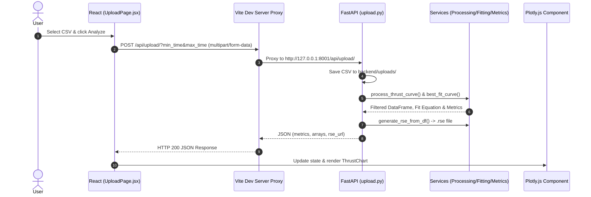
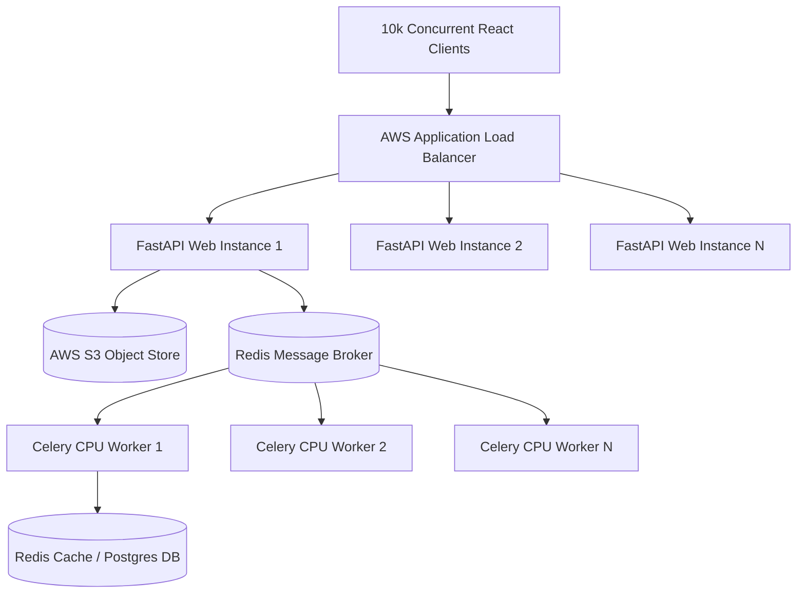
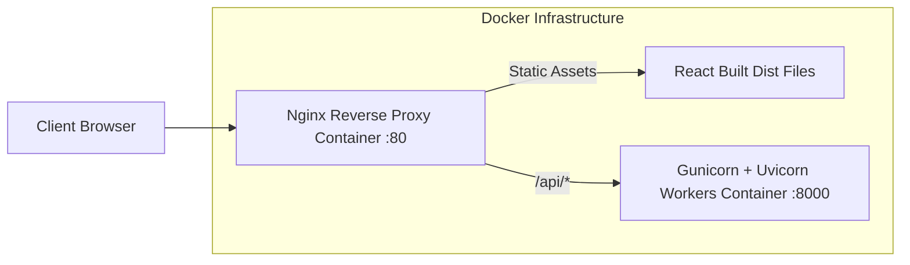
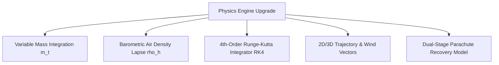

Listed directory frontend
Viewed package.json:1-35
Viewed vite.config.js:1-21
Listed directory src
Listed directory pages
Listed directory components
Viewed App.jsx:1-25
Viewed UploadPage.jsx:1-216
Viewed SimulatePage.jsx:1-272
Viewed MotorComparisonPage.jsx:1-306
Viewed PlotlyChart.jsx:1-35
Viewed SimChart.jsx:1-79
Viewed ThrustChart.jsx:1-54
Viewed ErrorBoundary.jsx:1-21
Listed directory data
Listed directory docs
Viewed motor.csv:1-74
Viewed TTI%20TIVRA%20K-925%20Thrust%20Vs%20Time%20Data%20%28Motor%20A%29.csv:1-62

# 🚀 Rocket Motor Analysis & Flight Simulation: Technical Interview Master Question Bank

This document contains **35 high-value, non-redundant interview questions** derived from a full codebase audit of the **Rocket Motor Analysis** project. 

Each primary question consolidates common question variants to prevent repetition, providing project-specific technical depth, exact code file paths, mathematical formulas, and architectural trade-offs.

---

## 1. Project Definition & Motivation

### Q1. What is the core purpose of this Rocket Motor Analysis application, and what real-world problem does it solve?

**Category:** Project Definition & Motivation  
**Difficulty:** Basic  
**Priority:** 🔴 **Must Know**

**Why the interviewer asks this:**  
To test whether you understand the domain domain context, high-level business logic, and why this application exists beyond just writing code.

**Also asked as:**
* What problem does your application solve?
* Why did you build a rocket motor analysis platform?
* What are the real-world use cases for this project?

**Expected Answer:**  
In amateur and experimental rocketry, motor test stands collect raw thrust-versus-time sensor data (often sampled at sub-second intervals with high noise). Rocket builders need to convert this raw CSV data into actionable engineering metrics—such as total impulse, average thrust, peak thrust, and burn duration—to classify motors (e.g., standard NAR/TRIPOLI motor designations like H, I, J motors) and predict flight altitude.

This full-stack application automates the data processing pipeline:
1. **Ingests and normalizes raw thrust-time CSV curves**, applying rolling-average smoothing (`rolling(window=3)`).
2. **Computes core motor performance metrics** using trapezoidal numerical integration ($I = \int F(t) dt$).
3. **Fits mathematical regression models** (linear, quadratic, sinusoidal) using SciPy to find the analytical best-fit model.
4. **Exports standard RockSim `.rse` files** so rocketry software (like RockSim or OpenRocket) can import custom motor curves.
5. **Executes 1D dynamic flight simulations** ($F_{net} = T(t) - mg - D$) to project rocket velocity and peak altitude before actual launch.

**Important points I must mention:**
• Resolves raw test-stand sensor data ingestion and noise issues.  
• Computes standardized impulse metrics and motor classification data.  
• Exports interoperable XML-based `.rse` motor files for industry tools.  
• Runs preliminary 1D flight dynamic simulations using Newton’s 2nd Law.

**Possible follow-up questions:**
* What standard file formats exist in high-power rocketry besides `.rse`? (e.g., RASP `.eng` files).

---

### Q2. Who are the intended users of this application, and what are its key functional boundaries and operational limitations?

**Category:** Project Definition & Motivation  
**Difficulty:** Basic  
**Priority:** 🟠 **Important**

**Why the interviewer asks this:**  
To gauge your awareness of user personas, practical scope, and system boundaries.

**Also asked as:**
* What are the limitations of this system?
* Who would use this software in a real environment?
* What features are explicitly out of scope?

**Expected Answer:**  
The primary target users are experimental rocketry teams, university aerospace clubs (such as SAEC/Spaceport America Cup teams), and amateur motor manufacturers testing solid or hybrid propulsion units on static test rigs.

**Key Functional Boundaries & Limitations:**
1. **No Database Persistence:** Currently, uploaded files and simulation runs are stateless or stored temporarily in local filesystem directory `backend/uploads/`.
2. **1D Point-Mass Dynamics:** The flight simulator assumes purely vertical 1-Degree-of-Freedom (1DoF) flight without wind vectors, pitch/yaw stability, or 3D trajectory modeling.
3. **Constant Rocket Mass:** The simulator treats rocket mass ($m$) as fixed during flight, neglecting solid fuel mass burn-off (which reduces mass over burn time).
4. **No User Authentication or Session Isolation:** Concurrent uploads overwrite files with matching names in `backend/uploads/`.

**Important points I must mention:**
• Target users: Experimental rocketry builders and university aerospace teams.  
• System boundary: 1D vertical point-mass simulation without 3D aerodynamics.  
• Limitations: Lack of database persistence, constant mass assumption during burn, and local filesystem dependency.

---

## 2. Project Workflow

### Q3. Walk me through the end-to-end flow of uploading a thrust CSV file and visualizing the analysis results.

**Category:** Project Workflow  
**Difficulty:** Basic  
**Priority:** 🔴 **Must Know**

**Why the interviewer asks this:**  
To evaluate whether you understand the full lifecycle of data moving from frontend UI interactions across network boundaries to backend endpoints and back to chart rendering.

**Also asked as:**
* What happens internally when a user clicks "Analyze"?
* Explain the request-response lifecycle for single motor analysis.
* Trace data from the file input element to Plotly visualization.

**Expected Answer:**  
1. **User Action:** On the frontend [`UploadPage.jsx`](file:///d:/Rocket_motor_analysis/frontend/src/pages/UploadPage.jsx), the user selects a `.csv` file and optional `min_time`/`max_time` range inputs, then clicks "Analyze".
2. **HTTP POST Request:** React uses Axios to dispatch a `multipart/form-data` POST request to `/api/upload/?min_time=X&max_time=Y`.
3. **Vite Proxy:** Vite server (`vite.config.js`) proxies `/api/*` to the FastAPI backend running at `http://127.0.0.1:8001`.
4. **FastAPI Route ([`upload.py`](file:///d:/Rocket_motor_analysis/backend/app/routes/upload.py)):**
   - Saves the raw file to `backend/uploads/filename.csv`.
   - Calls `process_thrust_curve(df)` in [`thrust_processing.py`](file:///d:/Rocket_motor_analysis/backend/app/services/thrust_processing.py) to normalize column headers, interpolate missing values, and apply a 3-point rolling average filter.
   - Calls `best_fit_curve()` in [`curve_fitting.py`](file:///d:/Rocket_motor_analysis/backend/app/services/curve_fitting.py) to evaluate linear, quadratic, and sinusoidal fits using SciPy/NumPy and select the lowest MSE model.
   - Filters time range using `filter_range()`.
   - Calls `compute_metrics()` in [`metrics_calc.py`](file:///d:/Rocket_motor_analysis/backend/app/services/metrics_calc.py) to calculate total impulse via `np.trapezoid()`, average thrust, peak thrust, and burn duration.
   - Generates a RockSim `.rse` XML file using [`rse_generator.py`](file:///d:/Rocket_motor_analysis/backend/app/utils/rse_generator.py).
5. **HTTP JSON Response:** FastAPI returns JSON containing metrics, equation string, best-fit curve coordinates, time/thrust arrays, and the `.rse` download URL.
6. **Frontend State & Render:** `UploadPage.jsx` updates local React state (`setResult(res.data)`), triggering a re-render of [`ThrustChart.jsx`](file:///d:/Rocket_motor_analysis/frontend/src/components/ThrustChart.jsx), which uses a dynamic wrapper around Plotly.js ([`PlotlyChart.jsx`](file:///d:/Rocket_motor_analysis/frontend/src/components/PlotlyChart.jsx)) to render measured vs ideal curves.



**Important points I must mention:**
• Axios sends `multipart/form-data` mapped through Vite proxy.  
• Backend executes validation, rolling average, SciPy regression fitting, trapezoidal impulse integration, and XML generation.  
• Frontend receives JSON array primitives and passes them to Plotly.js charts wrapped inside React Error Boundaries.

---

### Q4. How does the motor comparison workflow operate from frontend selection to backend metric evaluation and visual rendering?

**Category:** Project Workflow  
**Difficulty:** Intermediate  
**Priority:** 🟠 **Important**

**Why the interviewer asks this:**  
To test your understanding of multi-file upload processing, multi-dataset frontend plotting, and comparative scoring logic.

**Also asked as:**
* How do you compare two rocket motors side-by-side?
* Explain the execution flow of `MotorComparisonPage.jsx`.

**Expected Answer:**  
In [`MotorComparisonPage.jsx`](file:///d:/Rocket_motor_analysis/frontend/src/pages/MotorComparisonPage.jsx):
1. **Multi-file Ingestion:** The user selects two separate CSV files (`motor1` and `motor2`).
2. **Form Submission:** `handleSubmit()` builds a `FormData` object with `motor1` and `motor2` payloads and posts to `/api/compare-motors/` (defined in [`motor_compare.py`](file:///d:/Rocket_motor_analysis/backend/app/routes/motor_compare.py)).
3. **Backend Parallel Processing:** The endpoint reads both file streams using `process_csv()`, normalizing headers, stripping non-data metadata lines, and parsing numeric series.
4. **Metric Calculation:** Calculates `max_thrust`, `total_impulse`, and `burn_time` for both datasets.
5. **Response & Multi-Trace Plotting:** The frontend receives JSON containing both motors' metric objects and time/thrust time-series arrays.
6. **Overlay Rendering & Scoring:**
   - Plots both motors on a single Plotly canvas with distinct line colors (`#f87171` for Motor 1, `#c084fc` for Motor 2).
   - Runs `getBestMotor()` on the client: compares metrics head-to-head (+1 point per category won) and highlights the overall winner card.

**Important points I must mention:**
• Dual `multipart/form-data` payload in a single HTTP POST request.  
• Multi-trace overlay visualization in Plotly.  
• Client-side scoring algorithm evaluating max thrust, total impulse, and burn duration.

---

## 3. Architecture

### Q5. Describe the high-level architecture of this application. Why was a decoupled client-server architecture chosen over a monolith or SSR app?

**Category:** Architecture  
**Difficulty:** Intermediate  
**Priority:** 🔴 **Must Know**

**Why the interviewer asks this:**  
To verify that you can articulate system design principles, separation of concerns, and framework selection rationale.

**Also asked as:**
* Explain the architectural design of this project.
* Why decoupled React + FastAPI instead of Next.js or Django templates?

**Expected Answer:**  
The project uses a **decoupled Client-Server (REST API + Single Page Application) Architecture**:
* **Backend:** Built with Python (FastAPI), running on an ASGI server (Uvicorn). It acts purely as a stateless computation and data processing engine.
* **Frontend:** Built with React 19 and Vite. It acts as an interactive client rendering UI components, running dynamic Plotly charts, and managing UI state.

**Why Decoupled Client-Server over Monolithic SSR (Server-Side Rendering):**
1. **Computational Offloading vs UI Responsiveness:** Motor analysis involves intensive NumPy matrix operations and SciPy curve fitting. A decoupled client allows interactive UI state changes (tab toggling between velocity/altitude, plot zooming, filter adjusting) without requiring full page reloads or server roundtrips.
2. **API Reusability:** The FastAPI endpoints return structured JSON (`metrics`, `time`, `thrust`, `simulation`). This REST API can easily serve mobile apps, CLI tools, or automated test-stand hardware ingestion units in the future.
3. **Ecosystem Match:** Python is the undisputed industry standard for mathematical computation (Pandas, SciPy, NumPy), while React offers the richest client-side interactive graphing ecosystem (Plotly.js).

**Important points I must mention:**
• Clean REST API separation between Python backend and React frontend.  
• Avoids server roundtrips for rich client-side plotting and tab switching.  
• Capitalizes on Python's science stack and React's frontend ecosystem.

---

### Q6. How does data flow between the React frontend and FastAPI backend, and how are API request proxies configured during development vs production?

**Category:** Architecture  
**Difficulty:** Intermediate  
**Priority:** 🟠 **Important**

**Why the interviewer asks this:**  
To test your knowledge of web networking, CORS handling, client environment setup, and reverse proxies.

**Also asked as:**
* How do the frontend and backend communicate?
* Why is `vite.config.js` configuring a proxy?
* What happens with CORS in this setup?

**Expected Answer:**  
During development, the React application is served by the Vite dev server on `http://localhost:5173`, while the FastAPI backend runs on `http://127.0.0.1:8001`.

Because the browser blocks cross-origin requests by default (Same-Origin Policy), request calls like `axios.post("/api/upload/", ...)` would fail without proper CORS headers. 

To solve this cleanly in development, [`vite.config.js`](file:///d:/Rocket_motor_analysis/frontend/vite.config.js) defines a dev proxy rule:
```javascript
server: {
  proxy: {
    '/api': env.VITE_API_PROXY_TARGET || 'http://127.0.0.1:8001',
  },
}
```
When the client makes a request to `/api/upload/`, the Vite dev server forwards the request directly to Uvicorn at port 8001 backend server-to-server, bypassing browser CORS restrictions.

**In Production:**
In production, a reverse proxy like **Nginx** or **Traefik** would be placed in front of both static frontend build assets (`dist/`) and Uvicorn, routing `/api/*` requests to FastAPI and all other paths to static `index.html`. Alternatively, FastAPI must explicitly enable `CORSMiddleware` (`fastapi.middleware.cors`).

**Important points I must mention:**
• Vite dev proxy intercepts `/api` calls and forwards to Uvicorn at `http://127.0.0.1:8001`.  
• Solves Same-Origin Policy / CORS barriers during development.  
• Production deployment requires Nginx reverse proxy or FastAPI `CORSMiddleware`.

---

### Q7. What are the architectural limitations of storing uploaded files and generated RSE files directly on the local filesystem?

**Category:** Architecture  
**Difficulty:** Advanced  
**Priority:** 🔴 **Must Know**

**Why the interviewer asks this:**  
To evaluate your production system design awareness regarding statefulness, cloud storage, horizontal scaling, and security.

**Also asked as:**
* What is wrong with storing files in `backend/uploads/`?
* Why is local storage non-scalable in modern cloud environments?
* How would you redesign the storage layer?

**Expected Answer:**  
In [`upload.py`](file:///d:/Rocket_motor_analysis/backend/app/routes/upload.py), files are stored directly on the local server disk:
```python
file_path = os.path.join(UPLOAD_FOLDER, filename)
```

**Architectural Limitations:**
1. **Stateful Servers (Prevents Horizontal Scaling):** If FastAPI is horizontally scaled across 3 Docker container instances behind a load balancer, an upload processed on Instance A will save `.rse` to Instance A's local disk. When the user requests a download via `/api/upload/download-rse/?filename=...`, the load balancer may route the request to Instance B, resulting in a `404 File Not Found` error.
2. **Ephemeral Disk Data Loss:** In serverless environments (AWS ECS Fargate, Kubernetes pods, Heroku), container filesystems are ephemeral. Re-deploying or restarting a container wipes all uploaded and generated files.
3. **Filename Collisions & Race Conditions:** If two users simultaneously upload `motor.csv`, one user's file overwrites the other user's file.

**Production Redesign:**
Replace local disk storage with an object store like **AWS S3** or **MinIO**. Generate unique UUID-prefixed file keys, store metadata in PostgreSQL, and issue pre-signed S3 URLs for downloads.

**Important points I must mention:**
• Local filesystem makes the application stateful and breaks horizontal scaling across instances.  
• Ephemeral cloud container restarts cause data loss.  
• Race conditions and filename overwrite bugs.  
• Solution: S3 object storage with UUID keys and pre-signed download URLs.

---

## 4. Tech Stack

### Q8. Why did you choose FastAPI over Flask or Django for the backend framework?

**Category:** Tech Stack  
**Difficulty:** Intermediate  
**Priority:** 🔴 **Must Know**

**Why the interviewer asks this:**  
To test if you can justify your framework choice based on performance, type safety, API design, and async capabilities.

**Also asked as:**
* Why FastAPI?
* What advantages does FastAPI offer compared to Flask or Django?
* Did you consider Django REST Framework?

**Expected Answer:**  
1. **Asynchronous Architecture (ASGI vs WSGI):** FastAPI is built on Starlette and ASGI, natively supporting asynchronous non-blocking request handlers (`async def`). Flask and standard Django are legacy WSGI frameworks.
2. **Automatic Data Validation & Pydantic:** FastAPI seamlessly integrates Pydantic for request body serialization and data parsing. It automatically converts JSON request fields into validated Python primitives and generates 422 Unprocessable Entity responses for invalid types.
3. **Interactive OpenAPI (Swagger) Documentation:** FastAPI autogenerates interactive swagger documentation at `/docs` and `/redoc` directly from Python type annotations, reducing documentation overhead.
4. **Performance:** Benchmarks show FastAPI is among the fastest Python web frameworks available (comparable to NodeJS and Go), which is crucial when handling high-frequency sensor payloads.

**Important points I must mention:**
• ASGI async performance foundation via Starlette and Uvicorn.  
• Built-in Pydantic schema validation and parsing.  
• Automatic OpenAPI / Swagger UI generation at `/docs`.  
• Lean footprint compared to heavy Django ORM overhead.

---

### Q9. Why did you use React with Vite and Plotly.js on the frontend instead of Chart.js or D3.js?

**Category:** Tech Stack  
**Difficulty:** Intermediate  
**Priority:** 🟠 **Important**

**Why the interviewer asks this:**  
To evaluate frontend tooling knowledge, bundler selection (Vite vs CRA), and chart library selection for scientific scientific visualization.

**Also asked as:**
* Why Vite instead of Create React App?
* Why Plotly.js over Chart.js or D3.js?

**Expected Answer:**  
* **Vite over Create React App (CRA):** Vite leverages native ES Modules (ESM) and esbuild (written in Go) during development, producing instant server startup and ultra-fast Hot Module Replacement (HMR), whereas Webpack-based CRA is deprecated, slow, and unmaintained.
* **Plotly.js over Chart.js or D3.js:**
  - **Chart.js** is built primarily for basic business dashboards (bar charts, pie charts). It lacks advanced scientific charting tools like multi-axis overlays, hover inspection crosshairs, zoom/pan bounds, and numerical array streaming required for aerospace flight curves.
  - **D3.js** provides lower-level SVG DOM manipulation primitives, requiring hundreds of lines of custom boilerplate code to build axes, legends, tooltips, and responsive scaling.
  - **Plotly.js** provides out-of-the-box high-performance scientific plotting features (scatter lines, multi-trace datasets, customized hover templates, automated autosizing) via declarative configuration objects.

**Important points I must mention:**
• Vite provides modern ESM build speeds and fast HMR over legacy Webpack.  
• Plotly natively supports scientific coordinate systems, hover templates, and trace overlays out-of-the-box.  
• Avoids the low-level rendering overhead of D3.js and the functional simplicity of Chart.js.

---

### Q10. What role do Pandas, NumPy, and SciPy play in the data processing pipeline, and why were they selected over pure Python?

**Category:** Tech Stack  
**Difficulty:** Basic  
**Priority:** 🔴 **Must Know**

**Why the interviewer asks this:**  
To confirm your understanding of Python's scientific computing stack and C-optimized vectorized operations.

**Also asked as:**
* Why are NumPy and Pandas necessary for this project?
* Could you implement thrust processing using pure Python lists?

**Expected Answer:**  
While raw Python lists could theoretically parse CSV numbers, they are slow and memory-inefficient due to Python object overhead and dynamic type checking.

* **Pandas:** Handles tabular data ingestion (`pd.read_csv`), missing value interpolation (`df.interpolate()`), windowed rolling averages (`df.rolling(window=3)`), and column transformations in single vectorized calls.
* **NumPy:** Stores time-series data as contiguous C-aligned typed arrays (`np.ndarray`), enabling ultrafast vectorized arithmetic ($O(N)$ vector ops) and numerical integration algorithms like `np.trapezoid(thrust, time)`.
* **SciPy:** Provides non-linear least-squares optimization (`scipy.optimize.curve_fit`), which implements the Levenberg-Marquardt algorithm to solve non-linear sinusoidal and polynomial curve fitting equations that cannot be solved with basic arithmetic.

**Important points I must mention:**
• Vectorized C-implementations eliminate Python list looping overhead.  
• Pandas simplifies column mapping, filtering, and rolling-window smoothing.  
• SciPy `curve_fit` executes non-linear optimization for model extraction.

---

## 5. Implementation & Code Understanding

### Q11. How does the backend normalize, clean, and validate raw uploaded CSV files in `thrust_processing.py`?

**Category:** Implementation & Code Understanding  
**Difficulty:** Intermediate  
**Priority:** 🔴 **Must Know**

**Why the interviewer asks this:**  
To test your understanding of defensible data processing pipelines and handling noisy real-world data files.

**Also asked as:**
* Explain the data cleaning steps in `process_thrust_curve()`.
* How do you handle column name variations in uploaded CSVs?

**Expected Answer:**  
In [`thrust_processing.py`](file:///d:/Rocket_motor_analysis/backend/app/services/thrust_processing.py):
1. **Header Cleaning:** `validate_data(df)` strips trailing whitespace, lowers character case, and removes parentheses from column names:
   ```python
   df.columns = [c.strip().lower().replace(" ", "").replace("(", "").replace(")", "") for c in df.columns]
   ```
2. **Alias Mapping:** Standardizes common test stand header variations (e.g., mapping `times`, `timesec`, `t` $\to$ `time`, and `thrustn`, `force` $\to$ `thrust`).
3. **Boundary Validation:** Throws a `ValueError` if required `time` or `thrust` columns are missing, or if any negative time or thrust values exist (`df["thrust"] < 0`).
4. **Sorting & Interpolation:** `clean_data(df)` sorts rows chronologically by `time` and calls `df.interpolate()` to fill missing values.
5. **Noise Reduction (Smoothing):** Applies a 3-point moving average filter:
   ```python
   df["thrust"] = df["thrust"].rolling(window=3, min_periods=1).mean()
   ```
6. **Precision Rounding:** Rounds values to 3 decimal places (`df.round(3)`).

**Important points I must mention:**
• Column normalization handles real-world header discrepancies (`force`, `t`, `thrustn`).  
• Boundary checks enforce physical invariants (non-negative thrust and time).  
• Rolling-window mean filter smooths sensor noise spikes.

---

### Q12. How does the curve fitting service (`curve_fitting.py`) select the best-fit regression model for a given motor's thrust curve?

**Category:** Implementation & Code Understanding  
**Difficulty:** Intermediate  
**Priority:** 🔴 **Must Know**

**Why the interviewer asks this:**  
To evaluate your understanding of mathematical regression algorithms, model selection, and error evaluation metrics.

**Also asked as:**
* Explain how `best_fit_curve()` determines the ideal thrust model.
* What models are fitted to the motor data, and how are errors evaluated?

**Expected Answer:**  
In [`curve_fitting.py`](file:///d:/Rocket_motor_analysis/backend/app/services/curve_fitting.py), the system evaluates three candidate mathematical models against the time ($x$) and thrust ($y$) data:
1. **Linear Model:** $y = ax + b$, solved using `scipy.optimize.curve_fit`.
2. **Quadratic Model:** $y = ax^2 + bx + c$, solved using `numpy.polyfit(x, y, 2)`.
3. **Sinusoidal Model:** $y = a \cdot \sin(bx + c)$, solved using `curve_fit` with `maxfev=10000`.

**Error Metric & Model Selection:**
For each candidate model that successfully converges, the predicted values ($\hat{y}$) are evaluated against actual thrust values ($y$) using **Mean Squared Error (MSE)**:
$$\text{MSE} = \frac{1}{N} \sum_{i=1}^N (y_i - \hat{y}_i)^2$$
The service selects the model with the minimum MSE using `min(results, key=lambda k: results[k]["error"])`, returning the model name, string equation, and predicted ideal curve points.

**Important points I must mention:**
• Evaluates 3 models: Linear, Quadratic, and Sinusoidal.  
• Evaluates model accuracy using Mean Squared Error (MSE).  
• Dynamically picks the model with the lowest MSE score.

---

### Q13. How is the total impulse of a rocket motor calculated in `metrics_calc.py`, and why is mathematical numerical integration required?

**Category:** Implementation & Code Understanding  
**Difficulty:** Intermediate  
**Priority:** 🔴 **Must Know**

**Why the interviewer asks this:**  
To check your understanding of numerical integration theory and how raw discrete sensor samples are converted into total energy metrics.

**Also asked as:**
* What is total impulse and how is it calculated in code?
* Why do you use `np.trapezoid` instead of simply summing thrust values?

**Expected Answer:**  
**Total Impulse ($I$)** represents the total momentum/energy transferred by the rocket motor over its burn duration. Mathematically, it is the definite integral of force with respect to time:
$$I = \int_{t_0}^{t_{\text{burn}}} F(t) \, dt$$

Because thrust stand sensors output discrete time-series data points $(t_0, F_0), (t_1, F_1), \dots, (t_n, F_n)$ rather than a continuous analytical function, we must perform **Numerical Integration**.

In [`metrics_calc.py`](file:///d:/Rocket_motor_analysis/backend/app/services/metrics_calc.py):
```python
total_impulse = np.trapezoid(thrust, time)
```
This applies the **Trapezoidal Rule**, computing the area of discrete trapezoids under adjacent data points:
$$I \approx \sum_{i=1}^{n-1} \frac{F(t_i) + F(t_{i+1})}{2} \cdot (t_{i+1} - t_i)$$

**Why Simple Summing (`sum(thrust)`) is Incorrect:**
A simple sum $\sum F_i$ ignores the time step $\Delta t = t_{i+1} - t_i$. If the sensor sampling rate changes (e.g., sampling at 100 Hz vs 10 Hz), a raw sum produces a value 10 times larger, whereas trapezoidal integration correctly computes physical Newton-seconds ($\text{N}\cdot\text{s}$).

**Important points I must mention:**
• Total impulse is the area under the thrust-time curve ($I = \int F dt$).  
• Calculated using SciPy/NumPy trapezoidal integration (`np.trapezoid`).  
• Simple summing ignores $\Delta t$, introducing sampling-rate dependence.

---

### Q14. Walk through the numerical physics implementation of the 1D flight simulator in `simulator.py`.

**Category:** Implementation & Code Understanding  
**Difficulty:** Intermediate  
**Priority:** 🔴 **Must Know**

**Why the interviewer asks this:**  
To test your knowledge of physics modeling, differential equation solving, and numerical time-stepping loops.

**Also asked as:**
* How does `simulate_flight()` calculate altitude and velocity?
* Explain the physics loop in `simulator.py`.

**Expected Answer:**  
In [`simulator.py`](file:///d:/Rocket_motor_analysis/backend/app/services/simulator.py), the system models vertical 1D motion by solving Newton’s Second Law:
$$F_{\text{net}} = T(t) - D - mg$$
where $T(t)$ is thrust, $m$ is mass, $g = 9.81 \, \text{m/s}^2$, and Aerodynamic Drag $D$ is given by:
$$D = \frac{1}{2} \rho C_d A v^2$$

**Integration Loop Step-by-Step:**
For each discrete time step $i$:
1. **Drag Force:** $D_i = 0.5 \cdot \text{rho} \cdot C_d \cdot \text{area} \cdot v_{i-1}^2$
2. **Acceleration:** $a_i = \frac{T_i - D_i - m \cdot g}{m}$
3. **Time Step Delta ($\Delta t$):** $\Delta t = t_i - t_{i-1}$ (with fallback safety $\Delta t = 0.01$ if $\Delta t \le 0$).
4. **Velocity Integration (Euler Method):** $v_i = v_{i-1} + a_i \cdot \Delta t$
5. **Altitude Integration (Euler Method):** $h_i = h_{i-1} + v_i \cdot \Delta t$

The function returns time-series arrays for `velocity`, `altitude`, and `acceleration`.

**Important points I must mention:**
• Newton’s 2nd Law: Net force equals Thrust minus Drag minus Gravity.  
• Quadratic drag equation ($D = \frac{1}{2} \rho C_d A v^2$).  
• Forward Euler numerical integration updating velocity and position per timestep $\Delta t$.

---

### Q15. How does the backend generate a standard RockSim (`.rse`) XML file from pandas dataframes in `rse_generator.py`?

**Category:** Implementation & Code Understanding  
**Difficulty:** Intermediate  
**Priority:** 🟠 **Important**

**Why the interviewer asks this:**  
To verify your capability to work with domain-specific XML file specifications and file generation utilities.

**Also asked as:**
* How do you create `.rse` files?
* What is the structural format of the generated RockSim file?

**Expected Answer:**  
In [`rse_generator.py`](file:///d:/Rocket_motor_analysis/backend/app/utils/rse_generator.py), the function `generate_rse_from_df()` parses the cleaned DataFrame and converts the time-series arrays into an XML string schema compliant with RockSim engine databases:

```xml
<?xml version="1.0" encoding="UTF-8"?>
<engine-database>
  <engine-list>
    <engine mfg="Custom" code="MyMotor" Type="reloadable" dia="24" len="100" initWt="0.05" propWt="0.02">
      <data>
        <eng-data t="0.0" f="0.0"/>
        <eng-data t="0.043" f="5.368"/>
        ...
      </data>
    </engine>
  </engine-list>
</engine-database>
```
The endpoint in `upload.py` writes this to disk at `backend/uploads/filename.rse` and returns a download link handled by FastAPI's `FileResponse(media_type="application/xml")`.

**Important points I must mention:**
• Custom XML generator matching the RockSim schema format.  
• Iterates through rows generating `<eng-data t="..." f="..."/>` tags.  
• Download served via FastAPI `FileResponse`.

---

### Q16. How does `PlotlyChart.jsx` dynamically import Plotly to overcome Vite CommonJS bundling issues?

**Category:** Implementation & Code Understanding  
**Difficulty:** Intermediate  
**Priority:** 🟠 **Important**

**Why the interviewer asks this:**  
To test your knowledge of dynamic module loading, Vite build optimization, and integrating heavy non-ESM third-party libraries into modern React apps.

**Also asked as:**
* Why did you dynamically load Plotly in React?
* Explain the implementation of `PlotlyChart.jsx`.

**Expected Answer:**  
Plotly.js is a very heavy library (~3MB uncompressed) that legacy builds bundle as CommonJS (CJS). When building with Vite (which expects native ES Modules), static imports like `import Plot from 'react-plotly.js'` often fail or crash due to CJS dynamic `require` statements during SSR or browser bundling.

To fix this cleanly, [`PlotlyChart.jsx`](file:///d:/Rocket_motor_analysis/frontend/src/components/PlotlyChart.jsx) implements dynamic `import()` inside `useEffect`:
```javascript
export default function Plot({ data, layout, style, config }) {
  const ref = useRef(null)
  const [Plotly, setPlotly] = useState(null)

  useEffect(() => {
    import('plotly.js-dist-min').then(mod => setPlotly(mod.default ?? mod))
  }, [])

  useEffect(() => {
    if (!Plotly || !ref.current) return;
    Plotly.newPlot(ref.current, data, layout, { responsive: true, ...config });
    return () => { if (ref.current) Plotly.purge(ref.current); };
  }, [Plotly, data, layout, config])

  return <div ref={ref} style={style} />
}
```
This isolates Plotly loading to runtime, preventing Vite bundle crashes and implementing code-splitting.

**Important points I must mention:**
• Prevents Vite build crashes caused by CommonJS dynamic requires in Plotly.  
• Enables code-splitting: loads Plotly asynchronously on demand.  
• Ensures proper cleanup by invoking `Plotly.purge(ref.current)` unmount handlers.

---

## 6. Design Decisions & Trade-offs

### Q17. In `motor_compare.py`, `total_impulse` is calculated using `df["thrust"].sum()` instead of trapezoidal integration (`np.trapezoid`). What trade-off or oversight does this represent, and how does it impact accuracy?

**Category:** Design Decisions & Trade-offs  
**Difficulty:** Advanced  
**Priority:** 🔴 **Must Know**

**Why the interviewer asks this:**  
To evaluate your ability to spot technical debt, code discrepancies, and mathematical flaws when auditing codebases.

**Also asked as:**
* Are there any inconsistency bugs between `upload.py` and `motor_compare.py`?
* Why is `df["thrust"].sum()` in motor comparison mathematically flawed?

**Expected Answer:**  
*(Codebase Audit Discovery)*:  
In [`metrics_calc.py`](file:///d:/Rocket_motor_analysis/backend/app/services/metrics_calc.py) (used by `upload.py`), `total_impulse` is computed accurately using trapezoidal integration (`np.trapezoid(thrust, time)`).

However, in [`motor_compare.py`](file:///d:/Rocket_motor_analysis/backend/app/routes/motor_compare.py), line 72 computes metrics as:
```python
def compute_metrics(df):
    return {
        "max_thrust": float(df["thrust"].max()),
        "total_impulse": float(df["thrust"].sum()),  # <--- BUGS / OVERSIGHT!
        "burn_time": float(df["time"].max())
    }
```

**Consequences & Impact:**
1. **Mathematical Inaccuracy:** `df["thrust"].sum()` calculates $\sum F_i$ without multiplying by time delta $\Delta t$. If Motor 1 has 500 rows sampled at 0.001s intervals and Motor 2 has 50 rows sampled at 0.01s intervals for the exact same physical burn, Motor 1's calculated total impulse will be reported as **10 times higher** simply because it has more rows!
2. **Technical Debt:** `motor_compare.py` duplicated CSV parsing and metric calculations instead of importing the central domain services from `app.services.metrics_calc`.

**Fix:**  
Refactor `motor_compare.py` to remove duplicate code and call `app.services.metrics_calc.compute_metrics(df)`.

**Important points I must mention:**
• Highlight this exact technical debt discovery from your codebase audit.  
• `motor_compare.py` omits $\Delta t$ scaling, distorting total impulse based on sampling density.  
• Solution: Eliminate code duplication by reusing `metrics_calc.py`.

---

### Q18. Why does the flight simulation assume a constant rocket mass ($m$) during burn, and how does this simplification affect physical accuracy?

**Category:** Design Decisions & Trade-offs  
**Difficulty:** Advanced  
**Priority:** 🔴 **Must Know**

**Why the interviewer asks this:**  
To test your ability to critique physics assumptions and evaluate engineering trade-offs between algorithm complexity and simulation accuracy.

**Also asked as:**
* What is the main limitation of your flight simulation physics model?
* How does variable mass affect rocket acceleration?

**Expected Answer:**  
**The Simplification:** In [`simulator.py`](file:///d:/Rocket_motor_analysis/backend/app/services/simulator.py), rocket mass `mass` is passed as a static scalar constant throughout the loop:
$$a_i = \frac{T_i - D_i - m \cdot g}{m}$$

**Physical Reality (The Ideal Rocket Equation):**  
In real solid or liquid rocket motors, **propellant mass accounts for 30% to 70% of total liftoff mass**. As the motor burns, fuel is expelled as exhaust at mass flow rate $\dot{m} = \frac{dm}{dt}$. Thus, total mass decreases over time:
$$m(t) = m_{\text{dry}} + m_{\text{propellant}}(t)$$

**Impact on Accuracy:**
1. **Under-predicted Acceleration & Altitude:** By keeping $m$ fixed at initial gross mass $m_{\text{wet}}$, the denominator in $a = F/m$ remains artificially large during the burn phase. This causes the simulation to **under-predict burnout velocity and peak apogee altitude**.
2. **Trade-off Rationale:** Assuming constant mass allowed building a lightweight 1D simulation without requiring users to input initial propellant weight and grain regression rates.

**How to Improve:**  
Require users to input wet mass $m_{\text{wet}}$ and dry mass $m_{\text{dry}}$, then compute instantaneous mass $m(t_i) = m_{\text{wet}} - \frac{I(t_i)}{I_{\text{total}}} \cdot (m_{\text{wet}} - m_{\text{dry}})$.

**Important points I must mention:**
• Real motors lose 30–70% of mass during propellant burn-off.  
• Constant mass assumption under-predicts acceleration toward burnout and underestimates peak altitude.  
• Fix: Dynamic mass integration $m(t)$ based on propellant consumption ratio.

---

### Q19. Why does the backend re-fit and re-filter data when query parameters `min_time` and `max_time` are provided, rather than cropping raw input first?

**Category:** Design Decisions & Trade-offs  
**Difficulty:** Intermediate  
**Priority:** 🟡 **Good to Know**

**Why the interviewer asks this:**  
To evaluate your understanding of order of operations in data processing pipelines.

**Also asked as:**
* Why is curve fitting performed on full data before filtering `min_time` and `max_time` in `upload.py`?

**Expected Answer:**  
In [`upload.py`](file:///d:/Rocket_motor_analysis/backend/app/routes/upload.py):
```python
# 1. Fit curve on full dataset
fit_result = best_fit_curve(df["time"], df["thrust"])
# 2. Filter dataframe by range
df_filtered = filter_range(df, min_time, max_time)
```
**Trade-off & Rationale:**
If the curve fitting algorithm (`best_fit_curve`) were executed *after* cropping data to a narrow `min_time`/`max_time` window (e.g., cropping to just 0.5s of a 4s burn), non-linear models (especially sinusoidal or quadratic fits) would overfit to the truncated segment, producing invalid global trajectory parameters.

Fitting the full dataset first captures the true global motor curve behavior, while cropping afterwards isolates the visualization window requested by the user.

**Important points I must mention:**
• Curve fitting requires global dataset bounds to avoid mathematical overfitting.  
• Order of operations: Fit globally $\to$ Crop locally for window inspection.

---

## 7. Performance

### Q20. What are the algorithmic time and space complexities of the thrust curve processing, curve fitting, and simulation pipelines?

**Category:** Performance  
**Difficulty:** Intermediate  
**Priority:** 🟠 **Important**

**Why the interviewer asks this:**  
To test fundamental Big-O analysis on data processing and iterative loops.

**Also asked as:**
* Analyze the time complexity of your backend services.
* How does the system scale with the number of CSV rows ($N$)?

**Expected Answer:**  
Let $N$ be the number of rows (data points) in the CSV file:

1. **Thrust Processing ([`thrust_processing.py`](file:///d:/Rocket_motor_analysis/backend/app/services/thrust_processing.py)):**
   - Sorting by time: $O(N \log N)$
   - Rolling mean & linear interpolation: $O(N)$
   - **Time Complexity:** $O(N \log N)$ | **Space Complexity:** $O(N)$

2. **Curve Fitting ([`curve_fitting.py`](file:///d:/Rocket_motor_analysis/backend/app/services/curve_fitting.py)):**
   - SciPy `curve_fit` / NumPy `polyfit`: Executes iterative optimization (max 10,000 iterations). Each iteration evaluates predictions across $N$ elements.
   - **Time Complexity:** $O(K \cdot N)$ where $K$ is optimization iterations. | **Space Complexity:** $O(N)$

3. **Flight Simulation ([`simulator.py`](file:///d:/Rocket_motor_analysis/backend/app/services/simulator.py)):**
   - Iterates sequentially through $N$ time steps updating scalar state variables.
   - **Time Complexity:** $O(N)$ | **Space Complexity:** $O(N)$ to store result lists.

**Summary:** The overall pipeline runs in **$O(N \log N)$ time and $O(N)$ space**. For typical CSV files ($N \approx 1,000$ to $10,000$ points), execution completes in $< 50$ milliseconds.

**Important points I must mention:**
• Sorting dominates raw processing at $O(N \log N)$.  
• Simulation loop runs in linear time $O(N)$.  
• Overall execution takes $<50\text{ms}$ for standard datasets.

---

### Q21. FastAPI is an asynchronous ASGI framework, but Python data processing libraries (Pandas, SciPy) are synchronous. How does this impact backend throughput under concurrent load?

**Category:** Performance  
**Difficulty:** Advanced  
**Priority:** 🔴 **Must Know**

**Why the interviewer asks this:**  
To test deep knowledge of Python's Event Loop, asyncio execution models, and thread pool execution under CPU-bound workloads.

**Also asked as:**
* How do CPU-bound Pandas operations affect FastAPI's event loop?
* Why can synchronous calls in `async def` endpoints block other requests?

**Expected Answer:**  
FastAPI runs on an `asyncio` event loop. When an endpoint is declared with `async def upload_csv(...)`, FastAPI executes that endpoint directly on the main single-threaded event loop.

**The Bottleneck:**  
In [`upload.py`](file:///d:/Rocket_motor_analysis/backend/app/routes/upload.py), synchronous CPU-bound operations (`pd.read_csv`, `curve_fit`, `np.trapezoid`) run directly inside an `async def` handler:
```python
@router.post("/")
async def upload_csv(...):
    df = pd.read_csv(file_path)  # Synchronous CPU-bound computation on main event loop!
    fit_result = best_fit_curve(...) # Blocks event loop!
```
While the CPU is executing SciPy curve fitting for User A, the single-threaded event loop is **completely blocked**, preventing FastAPI from accepting or processing concurrent HTTP requests from User B!

**How to Solve:**
1. **Option A (Defensive FastAPI Route Declaration):** Declare CPU-bound endpoints as normal synchronous functions (`def` instead of `async def`). FastAPI automatically offloads synchronous `def` routes to an external worker thread pool (`anyio.to_thread.run_sync`).
2. **Option B (Explicit Thread Offloading):** Wrap heavy calls using `fastapi.concurrency.run_in_threadpool`:
   ```python
   df = await run_in_threadpool(pd.read_csv, file_path)
   ```
3. **Option C (Celery/Redis Worker Queue):** For large batch simulations, offload execution to background Celery worker processes.

**Important points I must mention:**
• Synchronous CPU-heavy calls inside `async def` block FastAPI's single-threaded event loop.  
• Declaring routes with standard `def` forces FastAPI to automatically run them in a separate thread pool.  
• Production workloads should use Celery background task workers.

---

## 8. Scalability

### Q22. If 10,000 users were uploading CSVs and running flight simulations simultaneously, what would be the primary backend and database bottlenecks, and how would you scale the system?

**Category:** Scalability  
**Difficulty:** Advanced  
**Priority:** 🔴 **Must Know**

**Why the interviewer asks this:**  
To evaluate your capacity to scale web applications horizontally under massive concurrent CPU and I/O load.

**Also asked as:**
* How would you architect this project to handle 10k concurrent users?
* Design a scalable architecture for rocket motor simulations.

**Expected Answer:**  



**Bottlenecks at 10,000 Concurrent Users:**
1. **CPU Exhaustion:** SciPy curve fitting and integration are CPU-intensive. 10k simultaneous computations will exhaust CPU cores immediately.
2. **Disk I/O Bottleneck:** Writing 10k CSV and `.rse` files to local disk causes disk queue saturation and I/O lockup.
3. **Event Loop Blocking:** As established in Q21, un-offloaded sync tasks lock Uvicorn workers.

**Scalability Architecture Solution:**
1. **Stateless Web Tier:** Containerize FastAPI apps into Docker images and deploy behind an AWS Application Load Balancer (ALB) auto-scaling group.
2. **Object Storage:** Decouple file storage completely by streaming CSV uploads directly to **AWS S3**.
3. **Asynchronous Task Queue (Celery + Redis):** When a user submits a simulation, FastAPI enqueues a job ID to Redis and returns HTTP 202 Accepted. Background **Celery workers** process the CPU-intensive curve fitting and simulation asynchronously.
4. **Caching Layer:** Cache curve fitting results in Redis using the CSV file hash (`SHA-256`) as the key. If 500 users upload the same standard commercial motor file (e.g., `Estes_C6-5.csv`), serve cached results instantly in $O(1)$ time without re-running fitting algorithms.

**Important points I must mention:**
• Horizontal auto-scaling of stateless FastAPI web containers.  
• Asynchronous job processing via Celery + Redis message queue.  
• Decoupled S3 file storage.  
• Content-hash caching (SHA-256) of fitted curves in Redis.

---

### Q23. How could you offload heavy curve fitting and flight simulation tasks using background job queues?

**Category:** Scalability  
**Difficulty:** Advanced  
**Priority:** 🟠 **Important**

**Why the interviewer asks this:**  
To test your familiarity with asynchronous background worker patterns (Celery, ARQ, Redis Queue).

**Also asked as:**
* Explain how job queues work in Python.
* How would you handle non-blocking simulation processing?

**Expected Answer:**  
Instead of waiting synchronously for `best_fit_curve()` to finish inside the HTTP POST endpoint:
1. **Endpoint Request:** The API route receives the upload, saves the file to S3, pushes a task `run_motor_analysis_task.delay(file_key)` to a **Redis queue**, and immediately returns a `task_id` with HTTP 202 status.
2. **Worker Processing:** Celery worker processes pull tasks from Redis, execute pandas cleaning, SciPy fitting, and flight simulation, then save output JSON to PostgreSQL/Redis.
3. **Frontend Polling or WebSockets:** The React client polls `/api/tasks/{task_id}` or listens over a WebSocket channel (`ws://...`) for status updates (`PENDING` $\to$ `SUCCESS`), rendering charts as soon as the payload arrives.

**Important points I must mention:**
• Decouples HTTP request/response cycle from long-running execution.  
• Uses Redis as message broker and Celery/ARQ as background workers.  
• Delivers results via client polling or WebSockets.

---

## 9. Reliability & Failure Handling

### Q24. How does the application handle invalid CSV uploads, malformed numerical values, or corrupted input headers?

**Category:** Reliability & Failure Handling  
**Difficulty:** Intermediate  
**Priority:** 🔴 **Must Know**

**Why the interviewer asks this:**  
To evaluate error handling robustness, exception boundaries, and user feedback mechanics.

**Also asked as:**
* What happens if a user uploads a text file or malformed CSV?
* Trace error handling in `upload.py` and `thrust_processing.py`.

**Expected Answer:**  
Data validation operates defensively across multiple layers:

1. **Format Validation:** [`UploadPage.jsx`](file:///d:/Rocket_motor_analysis/frontend/src/pages/UploadPage.jsx) restricts file picker input to `accept=".csv"`.
2. **Column & Numeric Validation ([`thrust_processing.py`](file:///d:/Rocket_motor_analysis/backend/app/services/thrust_processing.py)):**
   - If required columns (`time`, `thrust`) are missing after alias mapping, throws `ValueError("CSV must contain 'time' and 'thrust' columns")`.
   - If negative time or thrust values exist, throws `ValueError("Time cannot be negative")`.
3. **Coercion of Invalid Characters ([`motor_compare.py`](file:///d:/Rocket_motor_analysis/backend/app/routes/motor_compare.py)):**
   - Uses `pd.to_numeric(df['time'], errors='coerce')` to transform invalid text strings (e.g., `"abc"`) into `NaN`, followed by `df.dropna()`.
4. **Top-Level Route Exception Handler ([`upload.py`](file:///d:/Rocket_motor_analysis/backend/app/routes/upload.py)):**
   - Wraps route logic in `try...except Exception as e`, logging stack traces via `logger.exception()` and returning JSON: `{"status": "error", "message": str(e)}`.
   - React detects `res.data.status === "error"` and updates UI error banners.

**Important points I must mention:**
• Multi-tiered input validation (frontend client restriction, backend schema check, pandas numeric coercion).  
• Explicit exception catching returning user-friendly JSON error messages instead of 500 server crashes.  
• `logger.exception()` logs stack traces for developer debugging.

---

### Q25. How does the React frontend use Error Boundaries (`ErrorBoundary.jsx`) to handle visualization rendering failures?

**Category:** Reliability & Failure Handling  
**Difficulty:** Intermediate  
**Priority:** 🟠 **Important**

**Why the interviewer asks this:**  
To evaluate your knowledge of React component lifecycle error handling and preventing UI white-screens when external charting components crash.

**Also asked as:**
* How do React Error Boundaries work in your project?
* What happens if Plotly.js fails to render invalid chart data?

**Expected Answer:**  
If a backend endpoint returns corrupted array data (e.g., `NaN` coordinates or mismatched array lengths), third-party canvas/SVG plotting libraries like Plotly.js can throw unhandled JavaScript errors during render, which would crash the entire React component tree (causing a blank white screen).

In [`ErrorBoundary.jsx`](file:///d:/Rocket_motor_analysis/frontend/src/components/ErrorBoundary.jsx):
```javascript
export default class ErrorBoundary extends Component {
  state = { error: null }
  static getDerivedStateFromError(error) {
    return { error: error.message }
  }
  render() {
    if (this.state.error) {
      return <div className="status-msg error">Chart error: {this.state.error}</div>
    }
    return this.props.children
  }
}
```
In `UploadPage.jsx`, `<ThrustChart />` is wrapped inside `<ErrorBoundary>`. If Plotly crashes, `getDerivedStateFromError` catches the error localized to the chart component, displaying a fallback error banner while keeping the rest of the application (upload form, navbar, inputs) fully functional.

**Important points I must mention:**
• Uses React Class Component lifecycle `getDerivedStateFromError`.  
• Catches component-level JavaScript crashes during Plotly canvas rendering.  
• Prevents whole-app white-screen failures by displaying localized fallback UI.

---

### Q26. What happens if `scipy.optimize.curve_fit` fails to converge when fitting non-linear curves (e.g. sinusoidal models)?

**Category:** Reliability & Failure Handling  
**Difficulty:** Intermediate  
**Priority:** 🟠 **Important**

**Why the interviewer asks this:**  
To test your resilience strategies when dealing with non-deterministic or non-convergent mathematical optimization algorithms.

**Also asked as:**
* How do you prevent SciPy optimization errors from crashing the backend?
* What happens if sinusoidal curve fitting throws a `RuntimeError`?

**Expected Answer:**  
Non-linear curve fitting via Levenberg-Marquardt (`curve_fit`) can fail to converge within `maxfev` iterations if the input motor curve is extremely erratic, throwing a `RuntimeError` or `OptimizeWarning`.

In [`curve_fitting.py`](file:///d:/Rocket_motor_analysis/backend/app/services/curve_fitting.py), each candidate fit model is isolated inside independent `try...except` blocks:
```python
# Sinusoidal fit
try:
    params, _ = curve_fit(sin_func, x, y, maxfev=10000)
    pred = sin_func(x, *params)
    results["sinusoidal"] = { ... }
except:
    pass  # Silently skip non-convergent fit models!
```
If sinusoidal fitting fails to converge, the exception is caught, and the model is skipped. The service then falls back to linear or quadratic fits. As long as at least one model succeeds, `best_fit_curve()` returns a valid result.

**Important points I must mention:**
• Isolated `try...except` blocks per candidate mathematical model.  
• Non-convergent fits pass gracefully without breaking the request.  
• System falls back automatically to stable polynomial/linear fits.

---

## 10. Security

### Q27. What file upload security vulnerabilities (e.g., path traversal, malicious payload uploads, storage exhaustion) exist in `upload.py`, and how should they be remediated?

**Category:** Security  
**Difficulty:** Advanced  
**Priority:** 🔴 **Must Know**

**Why the interviewer asks this:**  
To assess your application security mindset, vulnerability detection capability, and hardening skills.

**Also asked as:**
* Audit the security of `upload.py`.
* What security flaws exist in your upload endpoint?

**Expected Answer:**  
*(Codebase Audit Security Findings in [`upload.py`](file:///d:/Rocket_motor_analysis/backend/app/routes/upload.py))*:

1. **Path Traversal Vulnerability:**
   ```python
   filename = file.filename.replace(" ", "_")
   file_path = os.path.join(UPLOAD_FOLDER, filename)
   ```
   If a malicious attacker submits a filename like `../../etc/passwd` or `../../main.py`, `os.path.join` can overwrite critical system files!
   - *Fix:* Sanitize filenames using `werkzeug.utils.secure_filename()` or generate random UUID keys (`f"{uuid.uuid4()}.csv"`).

2. **Unrestricted File Extension / Executable Upload:**
   The endpoint does not validate file MIME types or extensions on the backend. An attacker could upload a `.py`, `.sh`, or `.exe` file.
   - *Fix:* Enforce extension whitelist checking (`if not filename.endswith('.csv'): raise HTTPException(400)`).

3. **Storage Exhaustion (Denial of Service):**
   There is no file size limit check. Uploading a 5GB file will fill up server memory and disk space.
   - *Fix:* Enforce byte-stream length checks (e.g., max 10MB limit).

4. **Arbitrary File Download Vulnerability ([`download_rse`](file:///d:/Rocket_motor_analysis/backend/app/routes/upload.py#L87)):**
   ```python
   @router.get("/download-rse/")
   def download_rse(filename: str):
       file_path = os.path.join(UPLOAD_FOLDER, filename)
       return FileResponse(path=file_path, ...)
   ```
   An attacker calling `/api/upload/download-rse/?filename=../config/settings.py` can read arbitrary server files!
   - *Fix:* Validate that `os.path.abspath(file_path)` stays within `UPLOAD_FOLDER`.

**Important points I must mention:**
• Highlight path traversal risks in unsanitized user filenames.  
• Identify arbitrary file download vulnerability in `download-rse`.  
• Propose fixes: UUID file naming, extension whitelisting, file size caps, and canonical path containment checks.

---

### Q28. Is API request validation sufficient in the FastAPI endpoints, and how would you introduce CORS policies, rate limiting, and authentication?

**Category:** Security  
**Difficulty:** Advanced  
**Priority:** 🟠 **Important**

**Why the interviewer asks this:**  
To test your knowledge of production API defense mechanisms.

**Also asked as:**
* How would you secure your FastAPI backend for production deployment?

**Expected Answer:**  
Currently, FastAPI routes lack explicit CORS restrictions, rate limiting, and authentication middleware.

**Production Hardening Steps:**
1. **CORS Policy Setup:** Add `CORSMiddleware` in [`main.py`](file:///d:/Rocket_motor_analysis/backend/app/main.py) allowing only trusted domain origins:
   ```python
   app.add_middleware(
       CORSMiddleware,
       allow_origins=["https://your-rocket-app.com"],
       allow_methods=["GET", "POST"],
       allow_headers=["*"],
   )
   ```
2. **Rate Limiting:** Implement `slowapi` (Redis-backed rate limiter) to restrict client IPs to e.g., 20 upload requests per minute, preventing DoS spam.
3. **Authentication:** Protect simulation and export endpoints using OAuth2 with JWT Bearer tokens (`fastapi.security.OAuth2PasswordBearer`).
4. **Pydantic Request Schemas:** Replace raw dictionaries in `simulation.py` (`data: dict`) with strict Pydantic schemas (`BaseModel`) to enforce field types at the gateway level.

**Important points I must mention:**
• Restrict origin domains via `CORSMiddleware`.  
• Prevent DoS attacks using IP rate limiting (`slowapi`).  
• Use Pydantic `BaseModel` schemas instead of untyped `dict` payloads.

---

## 11. Testing & Debugging

### Q29. How would you design unit tests and integration tests for the metric calculations, curve fitting, and simulation modules?

**Category:** Testing & Debugging  
**Difficulty:** Intermediate  
**Priority:** 🟠 **Important**

**Why the interviewer asks this:**  
To evaluate your software testing methodology (PyTest, mock data creation, fixture setup).

**Also asked as:**
* How do you test this project?
* Write a test strategy for `metrics_calc.py` and `simulator.py`.

**Expected Answer:**  
Using **PyTest** and **HTTPX** (FastAPI TestClient):

1. **Unit Testing Math Services (`pytest`):**
   - **Metrics Test:** Pass a synthetic rectangular thrust curve ($F=10\text{N}$ for $t=0$ to $t=2\text{s}$). Assert `total_impulse == 20.0`, `peak_thrust == 10.0`, `avg_thrust == 10.0`, and `burn_time == 2.0`.
   - **Simulation Physics Test:** Pass zero thrust ($T=0$). Assert that acceleration equals $-g - \text{drag}$, velocity decreases monotonically, and altitude follows free-fall parabolic equations.
2. **Integration Testing API Endpoints (`TestClient`):**
   - Use `io.BytesIO` to mock multipart CSV file uploads.
   - Post to `/api/upload/` and assert `response.status_code == 200`, checking that response JSON contains required keys (`metrics`, `ideal_curve`).
3. **Regression Testing:** Verify that `.rse` XML output matches standard schema snapshots.

**Important points I must mention:**
• Unit testing mathematical logic using known synthetic inputs (e.g. constant rectangular thrust curves).  
• Testing physics free-fall boundary conditions ($T=0$).  
• Integration testing endpoints using FastAPI `TestClient` and `BytesIO` file streams.

---

### Q30. What edge cases in rocket motor thrust curves (e.g. multi-stage thrust spikes, noisy sensor data, zero-duration burns) could break the pipeline?

**Category:** Testing & Debugging  
**Difficulty:** Intermediate  
**Priority:** 🟡 **Good to Know**

**Why the interviewer asks this:**  
To test your edge-case analytical thinking and domain validation awareness.

**Also asked as:**
* What edge cases could break your calculations?
* How does your system handle unusual CSV data?

**Expected Answer:**  
1. **Zero Burn Time ($t_{\text{max}} - t_{\text{min}} = 0$):**
   - In `metrics_calc.py`, `avg_thrust = total_impulse / burn_time`. If a CSV has only 1 data point or identical timestamps, `burn_time` becomes `0`, resulting in a `ZeroDivisionError`.
   - *Fix:* Guard check `if burn_time <= 0: raise ValueError("Burn time must be greater than zero")`.
2. **Multi-Peak / Dual-Stage Thrust Curves:**
   - Bimodal thrust curves (common in boost-sustain motor grains) break single sinusoidal or quadratic polynomial curve fitting, yielding huge Mean Squared Error (MSE).
   - *Fix:* Implement piecewise spline interpolation or high-order polynomial fits ($n=5$).
3. **Sensors Reading Negative Values:**
   - Uncalibrated load cells can drift below zero prior to ignition.
   - *Fix:* Handled in `thrust_processing.py` via `if (df["thrust"] < 0).any(): raise ValueError(...)` or baseline zero-clipping (`df["thrust"] = df["thrust"].clip(lower=0)`).

**Important points I must mention:**
• Zero division risk when calculating average thrust if burn time is zero.  
• Failure of simple quadratic/sinusoidal models on dual-stage (boost-sustain) motor curves.  
• Load cell sensor zero-drift issues.

---

## 12. Deployment & Production

### Q31. How would you containerize and deploy this application using Docker, Nginx, and production ASGI servers (Gunicorn/Uvicorn)?

**Category:** Deployment & Production  
**Difficulty:** Intermediate  
**Priority:** 🔴 **Must Know**

**Why the interviewer asks this:**  
To test your DevOps, containerization, and production web deployment skills.

**Also asked as:**
* How do you deploy this project to production?
* Create a Docker deployment plan for FastAPI + React.

**Expected Answer:**  



**Production Containerization Architecture:**
1. **Frontend Multi-Stage Dockerfile:**
   - *Stage 1 (Build):* `node:20-alpine` runs `npm install` and `npm run build` to generate static bundle files in `dist/`.
   - *Stage 2 (Production):* `nginx:alpine` copies `dist/` into Nginx web root `/usr/share/nginx/html`.
2. **Backend Dockerfile:**
   - `python:3.11-slim` installs dependencies from `requirements.txt`.
   - Runs Gunicorn managing Uvicorn worker processes:
     ```bash
     gunicorn app.main:app -w 4 -k uvicorn.workers.UvicornWorker --bind 0.0.0.0:8000
     ```
3. **Nginx Reverse Proxy (`docker-compose.yml`):**
   - Directs all standard routes (`/`) to static React files.
   - Proxies `/api/` traffic to the Gunicorn/FastAPI container at `http://backend:8000`.

**Important points I must mention:**
• Multi-stage Node/Nginx Docker build for frontend static assets.  
• Running Gunicorn with multiple Uvicorn worker processes (`UvicornWorker`) for multi-core scaling.  
• Nginx acts as the unified reverse proxy routing API requests and serving static files.

---

### Q32. How would you configure environment variables and build pipelines for frontend asset delivery via Vite?

**Category:** Deployment & Production  
**Difficulty:** Basic  
**Priority:** 🟡 **Good to Know**

**Why the interviewer asks this:**  
To check your understanding of client-side environment variable injection during build time.

**Also asked as:**
* How do environment variables work in Vite?
* How do you point the frontend to different backend URLs in staging vs production?

**Expected Answer:**  
Vite bakes environment variables into static JS bundles at **build time** (not runtime).

1. Environment variables must be prefixed with `VITE_` (e.g., `VITE_API_PROXY_TARGET` or `VITE_API_BASE_URL`).
2. Access variables in React code using `import.meta.env.VITE_API_BASE_URL`.
3. In [`vite.config.js`](file:///d:/Rocket_motor_analysis/frontend/vite.config.js), `loadEnv(mode, process.cwd(), '')` dynamically reads environment configurations depending on whether `--mode development` or `--mode production` is executed during `vite build`.

**Important points I must mention:**
• Vite requires `VITE_` prefix for client-accessible environment variables.  
• Access via `import.meta.env` instead of `process.env`.  
• Variables are injected into client static files during compile time.

---

## 13. Improvement & Future Scope

### Q33. If you were given two weeks to refactor and upgrade this codebase to production standards, what technical debt and duplicate code would you address first?

**Category:** Improvement & Future Scope  
**Difficulty:** Advanced  
**Priority:** 🔴 **Must Know**

**Why the interviewer asks this:**  
To evaluate your self-awareness, code review capabilities, and prioritization of technical debt refactoring.

**Also asked as:**
* What technical debt exists in this project?
* If you could rewrite one part of the codebase, what would it be?

**Expected Answer:**  
**Top 4 Technical Debt Refactoring Priorities:**

1. **Eliminate Duplicate CSV Processing & Metric Logic:**
   Merge [`motor_compare.py`](file:///d:/Rocket_motor_analysis/backend/app/routes/motor_compare.py)'s inline `process_csv` and `compute_metrics` into central service modules [`thrust_processing.py`](file:///d:/Rocket_motor_analysis/backend/app/services/thrust_processing.py) and [`metrics_calc.py`](file:///d:/Rocket_motor_analysis/backend/app/services/metrics_calc.py). This fixes the `df["thrust"].sum()` total impulse calculation flaw in motor comparison.
2. **Replace Local Filesystem Storage with S3:**
   Remove runtime file dependencies on `backend/uploads/`. Stream uploads to S3 buckets and issue pre-signed download URLs for `.rse` files.
3. **Introduce Pydantic Request & Response Schemas:**
   Replace unvalidated dictionaries in `simulation.py` (`data: dict`) with explicit Pydantic schemas (`SimulationRequest`, `SimulationResponse`), providing automatic schema validation and accurate OpenAPI docs.
4. **Implement CPU Thread Pool Offloading:**
   Wrap synchronous pandas/scipy calls in `async def` endpoints using `fastapi.concurrency.run_in_threadpool` to prevent event loop blocking.

**Important points I must mention:**
• Eliminate duplicate logic in `motor_compare.py` and fix the trapezoidal integration bug.  
• Migrate local storage to AWS S3.  
• Replace untyped `dict` bodies with Pydantic `BaseModel` schemas.  
• Offload heavy pandas/SciPy tasks off the FastAPI event loop.

---

### Q34. How would you enhance the physics fidelity of the flight simulator (2D/3D trajectory, variable mass burn-off, atmospheric lapse, parachute drag)?

**Category:** Improvement & Future Scope  
**Difficulty:** Advanced  
**Priority:** 🟠 **Important**

**Why the interviewer asks this:**  
To test your domain depth and capacity to extend basic mathematical models into advanced engineering simulations.

**Also asked as:**
* How would you make the flight simulator more realistic?
* What physical effects are currently missing from the simulation?

**Expected Answer:**  



1. **Dynamic Mass Burn-off ($m(t)$):** Integrate propellant loss rate $\dot{m}(t) = \frac{T(t)}{I_{sp} \cdot g_0}$ so rocket mass decreases accurately during burn.
2. **Barometric Altitude Lapse ($\rho(h)$):** Replace constant air density $\rho = 1.225 \, \text{kg/m}^3$ with the International Standard Atmosphere model:
   $$\rho(h) = \rho_0 \cdot e^{-h / H}$$
3. **Advanced Numerical Integration (RK4):** Replace Forward Euler integration ($O(\Delta t)$ error) with **4th-Order Runge-Kutta (RK4)** integration to reduce numerical integration drift over long flight durations.
4. **Recovery Phase & Parachute Drag:** Model apogee detection ($v \le 0$), deploying main/drogue parachutes with increased surface area $A_{\text{chute}}$ to simulate descent velocity and ground landing time.

**Important points I must mention:**
• Dynamic mass burn-off rate using specific impulse $I_{sp}$.  
• Barometric density lapse rate over altitude $\rho(h)$.  
• Upgrading numerical integration from Euler to RK4.  
• Modeling parachute deployment recovery phase after apogee.

---

### Q35. How would you extend the application to support database persistence, user accounts, and motor catalog search capabilities?

**Category:** Improvement & Future Scope  
**Difficulty:** Advanced  
**Priority:** 🟠 **Important**

**Why the interviewer asks this:**  
To evaluate your skills in extending a standalone utility into a full-fledged SaaS platform with database schemas and user management.

**Also asked as:**
* How would you add user accounts and database storage?
* Design a database schema for saving uploaded rocket motors.

**Expected Answer:**  
**Database Layer (PostgreSQL + SQLAlchemy / SQLModel):**
1. **`Users` Table:** `id`, `email`, `hashed_password`, `created_at`.
2. **`Motors` Table:** `id`, `user_id` (FK), `motor_name`, `manufacturer`, `total_impulse`, `peak_thrust`, `burn_time`, `rse_s3_url`, `created_at`.
3. **`ThrustDataPoints` Table (or JSONB):** `id`, `motor_id` (FK), `time_array`, `thrust_array`.

**Functional Architecture Upgrades:**
* **JWT Authentication:** Secure API routes using OAuth2 with Password Bearer tokens.
* **Motor Catalog Search:** Allow users to search, filter, and compare community-contributed motor curves (e.g., searching for all "I-Class motors with peak thrust $> 500\text{N}$").

**Important points I must mention:**
• PostgreSQL relational database design with foreign key constraints.  
• Storing time-series arrays as PostgreSQL JSONB or normalized child rows.  
• JWT authentication and public motor catalog search capabilities.

---

# 📊 Question Classification & Prioritization

### 🔴 Must-Know Questions (Core Interview Surface Area)
* **Q1:** Core purpose & problem domain
* **Q3:** End-to-end upload & analysis request lifecycle
* **Q5:** Decoupled React + FastAPI architecture rationale
* **Q7:** Architectural limitations of local filesystem storage (`backend/uploads/`)
* **Q8:** FastAPI framework selection over Flask/Django
* **Q10:** Role of Pandas, NumPy, SciPy C-extensions
* **Q11:** CSV cleaning, header normalization, and rolling average filtering
* **Q12:** SciPy curve fitting and MSE best-fit model selection
* **Q13:** Total impulse integration using `np.trapezoid`
* **Q14:** 1D numerical flight simulator loop implementation
* **Q17:** Code audit: `total_impulse` `sum()` flaw in `motor_compare.py`
* **Q18:** Physics trade-off of constant rocket mass assumption
* **Q21:** FastAPI single-threaded event loop blocking by CPU-bound Pandas/SciPy
* **Q22:** Scaling architecture to 10k users (Celery, Redis, S3, Auto-scaling)
* **Q24:** Input data validation & error handling layers
* **Q27:** Security audit: Path traversal & arbitrary file download vulnerabilities
* **Q31:** Docker containerization with multi-stage Nginx + Gunicorn/Uvicorn
* **Q33:** Technical debt refactoring plan

---

# ⚠️ Project Weak Points (Interviewer Vulnerability Map)

An experienced interviewer auditing this repository will likely zero in on these **5 major code & architecture flaws**. Be prepared to proactively acknowledge and defend them:

1. **Duplicate Code & Calculation Flaw in `motor_compare.py`:**
   - *Weakness:* `motor_compare.py` duplicates CSV parsing and metrics calculation. Crucially, it calculates `total_impulse` as `df["thrust"].sum()` instead of trapezoidal integration `np.trapezoid(thrust, time)`.
   - *Your Defense:* Acknowledge it immediately as technical debt identified during your audit, and explain how you would refactor it to call `metrics_calc.py`.

2. **Event-Loop Blocking in FastAPI:**
   - *Weakness:* CPU-intensive `curve_fit` and `pd.read_csv` execute synchronously inside `async def` routes, blocking Uvicorn's single-threaded event loop.
   - *Your Defense:* Explain that route definitions should be changed to synchronous `def` (so FastAPI offloads them to a thread pool) or dispatched to background Celery workers.

3. **Stateful Local File Storage (`backend/uploads/`):**
   - *Weakness:* Direct disk writes break horizontal auto-scaling and ephemeral cloud container deployments. Filenames can suffer collision overwrites.
   - *Your Defense:* Explain why cloud object storage (AWS S3) with UUID keys is the required production pattern.

4. **Security Vulnerabilities in File Operations:**
   - *Weakness:* `file.filename` is used directly in `os.path.join` (path traversal risk), and `download_rse` downloads arbitrary user-supplied file strings without path containment checks.
   - *Your Defense:* Detail remediation steps using filename sanitization, UUIDs, extension whitelisting, and `os.path.abspath` boundary checks.

5. **Physical Simplifications in Flight Simulator:**
   - *Weakness:* Simulator assumes constant rocket mass (ignoring fuel burn-off), constant sea-level air density $\rho$, and basic Euler numerical integration.
   - *Your Defense:* Frame this as a intentional engineering trade-off for v1 scope simplicity, and outline how to add dynamic mass integration $m(t)$, barometric lapse $\rho(h)$, and RK4 integration.

---

# 🎯 High-Risk Follow-Ups (Deep-Dive Probe Questions)

1. **"Why did you use `np.trapezoid` instead of `np.trapz`?"**
   - *Answer:* In recent NumPy releases ($\ge 2.0$), `np.trapz` was deprecated and renamed to `np.trapezoid`. Using `np.trapezoid` ensures compatibility with modern NumPy environments. (Note: `calculate_metrics` in `metrics_calc.py` still contains dead code referencing `np.trapz`, which should be cleaned up).

2. **"What happens if a user submits a CSV with 1,000,000 rows sampled at 100,000 Hz?"**
   - *Answer:* Pandas read time and SciPy curve fitting will take several seconds, blocking the process. Solution: Downsample the data using Lamer-Ramer-Douglas-Peucker (RDP) algorithm or pandas decimation (`df.iloc[::10]`) prior to fitting.

3. **"Why did you use `useRef` for input file triggers in React?"**
   - *Answer:* Hidden `<input type="file" style={{display: 'none'}} ref={inputRef} />` elements are styled manually via custom drop-zone `<div>` elements. Clicking the div triggers `inputRef.current.click()` programmatically.

---

# 📚 Core CS & Software Engineering Concepts to Revise

* **Numerical Analysis:** Definite integration (Trapezoidal Rule), Least-Squares Optimization (Levenberg-Marquardt algorithm), Mean Squared Error (MSE), Ordinary Differential Equations (Euler vs RK4).
* **Python Concurrency:** Event loops, ASGI vs WSGI, `asyncio`, thread pools vs process pools, GIL (Global Interpreter Lock) implications on CPU-bound code.
* **Web Architecture:** REST API design, Same-Origin Policy (CORS), Vite dev proxies vs production reverse proxies (Nginx), multi-stage Docker builds.
* **Web Security:** Path traversal, file upload vulnerabilities, DoS mitigation, parameter validation.

---

# ✅ Interview Readiness Checklist

- [ ] **30-Second Elevator Pitch:** Can articulate the project as a full-stack rocket motor thrust analysis & 1D flight simulation platform built with FastAPI and React.
- [ ] **1-Minute Deep-Dive:** Can explain the workflow: CSV ingestion $\to$ Pandas cleaning $\to$ SciPy curve fitting $\to$ Trapezoidal impulse integration $\to$ RockSim `.rse` export $\to$ 1D flight simulation $\to$ Plotly charts.
- [ ] **Architecture Defense:** Can defend the decoupled React + FastAPI design and explain Vite proxy configurations.
- [ ] **Implementation Mastered:** Can explain `process_thrust_curve()`, `best_fit_curve()`, `np.trapezoid()`, and `simulate_flight()`.
- [ ] **Technical Debt Identified:** Can point out the `motor_compare.py` total impulse `sum()` bug and duplicate logic.
- [ ] **Security Hardened:** Can identify path traversal vulnerability risks in file upload routes and propose S3 + UUID solutions.
- [ ] **Scalability Ready:** Can outline scaling FastAPI to 10k users using Celery, Redis queues, and stateless container auto-scaling.
- [ ] **Physics Defended:** Can explain the constant mass simplification in flight simulation and how to implement $m(t)$ dynamic mass loss.
